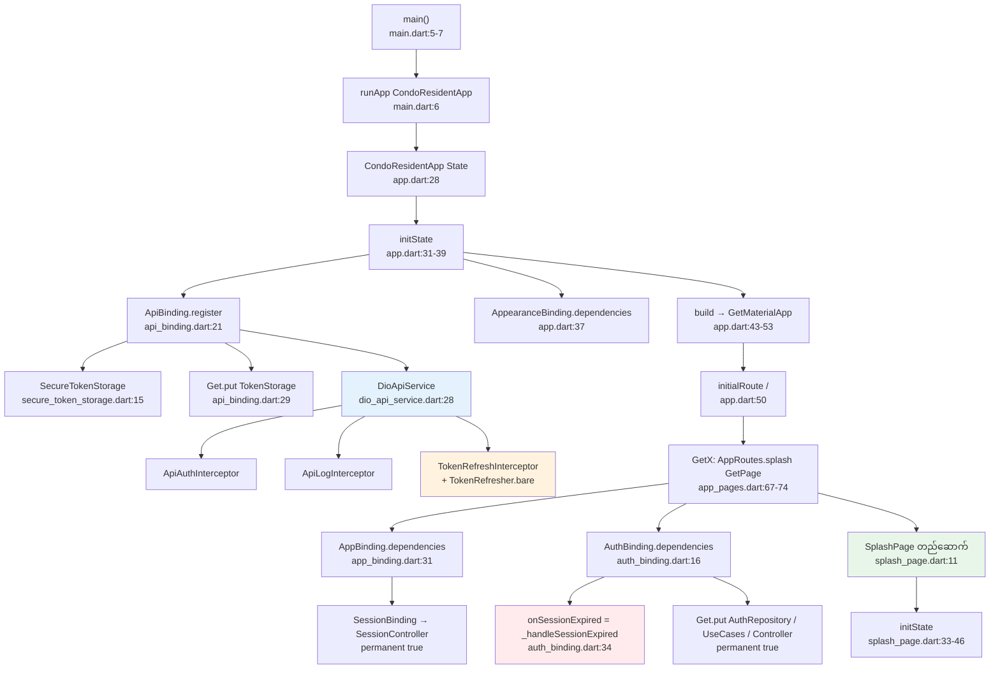
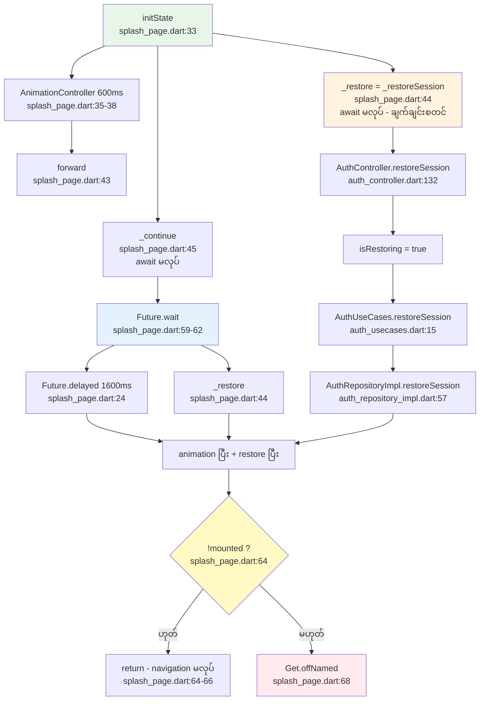
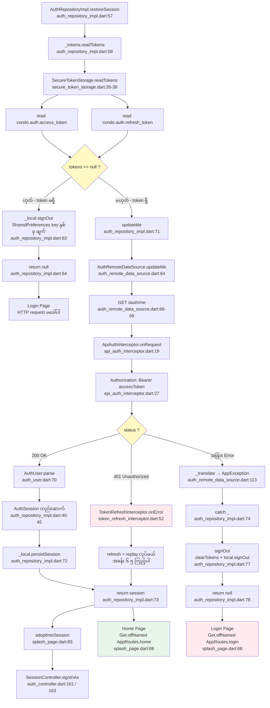
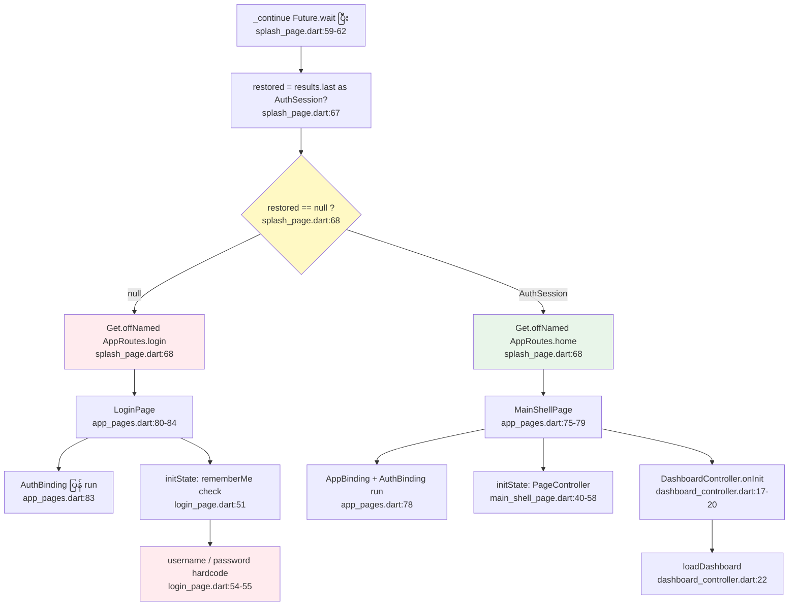
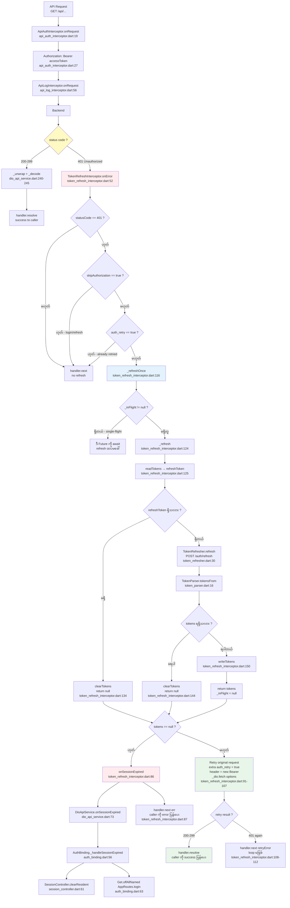

# Splash Screen, Restore Session နဲ့ DummyJSON Token Refresh Logic — အသေးစိတ် ရှင်းပြချက်

> **Project** — Flutter Matrix Condo
> **ဖိုင်** — `lib/`
> **ရည်ရွယ်ချက်** — App စဖွင့်လိုက်တဲ့အခါကနေ Home Page ဒါမှမဟုတ် Login Page ကို ရောက်တဲ့အထိ လက်ရှိ Code က အမှန်တကယ် ဘယ်လိုအလုပ်လုပ်နေသလဲ အသေးစိတ် ဖော်ပြထားတာပါ။
>
> **မှတ်သားရန်** — ဤစာရွက်ထဲက အချက်အလက်အားလုံးကို `lib/` folder ထဲက Source Code များကို တိုက်ရိုက်ဖတ်ပြီး ရေးထားတာဖြစ်ပါတယ်။ Code ထဲမှာ **မတွေ့ရတဲ့ Logic တွေကို ရှိနေသကဲ့သို့ မမှတ်ပြီး** တကယ်တွေ့ရှိတဲ့အတွက်သာ ဖော်ပြထားပါတယ်။
>
> **မှတ်ချက်** — ဤစာရွက်က documentation တစ်ခုတည်းသာ ဖြစ်ပြီး Source Code ကို မည်သူမျှ မပြင်ထားပါ။

---

## အကြောင်းအရာ အကျဉ်းချုပ်

Matrix Condo App က GetX Architecture ကို အသုံးပြုပြီး Dio ကို HTTP client အဖြစ်သုံးပါတယ်။ Session စီမံခြင်းကို **Clean Architecture** လမ်းကြောင်းအတိုင်း —

```
presentation (Controller / Page / Binding)
        ↓
domain (UseCase / Repository interface / Entity)
        ↓
data (RepositoryImpl / DataSource / Model)
        ↓
core (DioApiService / Interceptor / Storage)
```

— ခွဲထားပါတယ်။ Token refresh logic ကိုတော့ **core network layer** ထဲမှာပဲ ထားထားပါတယ်။

Session စီမံခြင်းက အဆင့် ၃ ဆင့်နဲ့ တည်ဆောက်ထားပါတယ် —

1. **Splash Screen** — App စတင်တဲ့အခါ ပထမဆုံးပေါ်တဲ့ Page။ Login/Home ကို ရွေးပေးတဲ့နေရာဖြစ်ပါတယ်။
2. **Restore Session** — အရင် Login လုပ်ထားတဲ့ Session ကို backend အတည်ပြုပြီး ပြန်လည်သုံးပါတယ်။
3. **Token Refresh** — `accessToken` သက်တမ်းကုန်သွားရင် `refreshToken` နဲ့ပြင်ထားတဲ့ token အစား အသစ်ရယူပြီး ပြန်စီးပါတယ်။

---

## အခန်း (၁) — Project Structure နှင့် သက်ဆိုင်သော Files

### ၁.၁ File များအားလုံး၏ တာဝန်နှင့် ဆက်စပ်မှု

| File Path | Class Name | တာဝန် | ဘယ်နဲ့ ဆက်စပ်သလဲ |
|---|---|---|---|
| `lib/main.dart` | `main()` | App စတင်ပြီး `CondoResidentApp` ကို `runApp` လုပ်ပါတယ်။ ကျန်တာ ဘာမှမလုပ်ပါ။ | `app/app.dart` ကို import လုပ်ပါတယ် (line 3)။ |
| `lib/app/app.dart` | `CondoResidentApp` / `_CondoResidentAppState` | App ရဲ့ root widget။ Network layer နဲ့ Theme ကို **ပထမဆုံး frame မှာပဲ** register လုပ်ပြီး `GetMaterialApp` ဆောက်ပါတယ်။ | `initState` (line 31-39) က `ApiBinding.register()` ကိုခေါ်ပါတယ်။ `initialRoute: AppRoutes.splash` (line 50) သတ်မှတ်ပါတယ်။ |
| `lib/app/routes/app_routes.dart` | `AppRoutes` | Route **အမည်** သာ သိမ်းထားတဲ့ constants။ Logic မပါဝင်ပါ။ | `splash = '/'` (line 2)၊ `login = '/login'` (line 3)၊ `home = '/home'` (line 4)။ |
| `lib/app/routes/app_pages.dart` | `AppPages` | Route အမည် → Page + Binding **စီမံကိန်း**။ | `GetMaterialApp.getPages` မှာ ပေးချိုးပါတယ်။ Splash entry (line 67-74) နဲ့ Home entry (line 75-79) တို့မှာ `AppBinding()` + `AuthBinding()` နှစ်ခုလုံး ရှိပါတယ်။ |
| `lib/app/pages/splash_page.dart` | `SplashPage` / `_SplashPageState` | **Splash Screen**။ Logo animation ပြသပြီး Restore Session စတင်ပြီး Login/Home ကို ဆုံးဖြတ်ပါတယ်။ | `AuthBinding` က ပေးတဲ့ `AuthController` ကို သုံးပါတယ် (line 76)။ `AppRoutes` ဆီ navigation လုပ်ပါတယ် (line 68)။ |
| `lib/app/bindings/app_binding.dart` | `AppBinding` | Feature Controller **၁၄ ခု** ကို app-scoped အဖြစ် register လုပ်ပါတယ်။ | Splash နဲ့ Home **နှစ်လုံး** မှာ binding အဖြစ်ရှိပြီး၊ comment (line 19-27) အတိုင်း `permanent: true` ဖြစ်လို့ ပြန်ခေါ်ရင်လည်း အမ်းတည်ပါတယ်။ |
| `lib/features/auth/presentation/controllers/auth_controller.dart` | `AuthController` | Login form နဲ့ Session ကို စီမံပါတယ်။ **Navigate လုပ်ခြင်း မလုပ်ပါ** (class comment line 10-19)။ | `AuthUseCases` ကို သုံးပါတယ်။ Restore ပြီးရင် `SessionController` ကို `adoptIntoSession()` (line 152) နဲ့ တွဲပေးပါတယ်။ |
| `lib/features/auth/presentation/bindings/auth_binding.dart` | `AuthBinding` | Auth layer အားလုံးကို `Get.put(permanent: true)` ဖြင့် register လုပ်ပါတယ်။ | `onSessionExpired` callback ကို **ဒီမှာပဲ** ချိတ်ပါတယ် (line 34)။ |
| `lib/features/auth/presentation/pages/login_page.dart` | `LoginPage` | Login form UI။ | `AuthController` ကို `Get.find` ဖြင့်ယူပြီး (line 46)၊ `signIn()` အောင်မြင်ရင် `Get.offAllNamed(AppRoutes.home)` (line 149) ပြောင်းပါတယ်။ |
| `lib/features/auth/domain/usecases/auth_usecases.dart` | `AuthUseCases` | Repository ကို pass-through ခေါ်ပါတယ်။ Logic အပြည့်အစုံ မပါဝင်ပါ။ | `AuthRepository` ကို သုံးပါတယ်။ |
| `lib/features/auth/domain/repositories/auth_repository.dart` | `AuthRepository` | Auth လုပ်တာတွေရဲ့ **contract** (interface)။ | `AuthRepositoryImpl` က အကားရှိတာ။ `restoreSession()` ရဲ့ doc (line 23-27) က `/auth/me` အတည်ပြုမှုကို ရှင်းထားပါတယ်။ |
| `lib/features/auth/data/repositories/auth_repository_impl.dart` | `AuthRepositoryImpl` | **Token စစ်ဆေးမှုနဲ့ `/auth/me` ခေါ်ခြင်း** ဒီနေရာမှာပါ (line 57-80)။ | `TokenStorage` နဲ့ `AuthLocalDataSource` ကို သုံးပါတယ်။ |
| `lib/features/auth/data/datasources/auth_remote_data_source.dart` | `AuthRemoteDataSource` | Backend နဲ့ တိုက်ဆိုင်တဲ့ API call တွေ (login / me / refresh)။ | Shared `DioApiService` ကို သုံးပါတယ် (line 29)။ |
| `lib/features/auth/data/datasources/auth_local_data_source.dart` | `AuthLocalDataSource` | **မလှူရင်လိုတဲ့** အချက်တွေသာ `SharedPreferences` မှာ သိမ်းပါတယ်။ | Token ကို ဒီမှာ **မသိမ်းပါ** (class comment line 6-10)။ |
| `lib/features/auth/data/models/auth_user.dart` | `AuthUser` | Backend က ပြန်ပေးတဲ့ နောက်ရင်းချက်။ `parse()` (line 70) က DioApiService ရဲ့ parser signature နဲ့ညီပါတယ်။ | `AuthSession.user` ထဲမှာ ပါဝင်ပါတယ်။ |
| `lib/features/auth/domain/entities/auth_session.dart` | `AuthSession` / `SignInRequest` | Domain အတွင်း session ကို ကိုယ်စားလုပ်တဲ့ object။ | **Password မပါဝင်ပါ** (class comment line 1-5)။ |
| `lib/core/network/dio_api_service.dart` | `DioApiService` | App ရဲ့ **HTTP client တစ်ခုတည်း**။ Base URL၊ timeout၊ interceptor အားလုံး စီမံပါတယ်။ | Constructor (line 28-61) မှာ interceptor ၃ ခု တပ်ပါတယ်။ |
| `lib/core/network/api_binding.dart` | `ApiBinding` | `DioApiService` နဲ့ `TokenStorage` ကို app-scoped register လုပ်ပါတယ်။ | `app.dart:36` နဲ့ `auth_binding.dart:26` ကနေခေါ်ပါတယ်။ |
| `lib/core/network/token_storage.dart` | `TokenStorage` (interface) / `AuthTokens` | Token သိမ်း/ဖတ်/ဖျက် နည်းလမ်း၏ **abstract သတ်မှတ်ချက်**။ | Interface အဖြစ် ရှိလို့ test မှာ in-memory fake ပြောင်းလဲနိုင်ပါတယ်။ |
| `lib/core/network/secure_token_storage.dart` | `SecureTokenStorage` | `TokenStorage` ရဲ့ **လက်တွေ့ implementation**။ `flutter_secure_storage` (platform keychain) သုံးပါတယ်။ | `ApiBinding.register()` က သောကြာသည် (api_binding.dart:28)။ |
| `lib/core/network/interceptors/api_auth_interceptor.dart` | `ApiAuthInterceptor` | ပို့တဲ့ request တိုင်းမှာ `Authorization: Bearer ...` header ဖြည့်ပါတယ်။ | `DioApiService` constructor က သောကြာသည် (dio_api_service.dart:35)။ |
| `lib/core/network/interceptors/token_refresh_interceptor.dart` | `TokenRefreshInterceptor` | `401 Unauthorized` ကို ဖမ်းပြီး refresh လုပ်ပါတယ်။ | `DioApiService` constructor က သောကြာသည် (dio_api_service.dart:48-52)။ |
| `lib/core/network/interceptors/api_log_interceptor.dart` | `ApiLogInterceptor` | Debug build များမှာ request/response log ပြီး credential တွေ ဖျက်ပါတယ်။ | `DioApiService` constructor က သောကြာသည် (dio_api_service.dart:58)။ |
| `lib/core/network/token_refresher.dart` | `TokenRefresher` | `POST /auth/refresh` ကို ခေါ်ပါတယ်။ `bare()` (line 55) က interceptor မရှိတဲ့ Dio ပေးပါတယ်။ | `TokenRefreshInterceptor._refresh()` က သုံးပါတယ် (line 139)။ |
| `lib/core/network/token_parser.dart` | `TokenParser` | Response JSON ထဲက token pair ကို ထုတ်ပါတယ်။ | Refresh interceptor နဲ့ login response နှစ်ခုလုံး သုံးပါတယ်။ |
| `lib/core/network/api_config.dart` | `ApiConfig` | Base URL၊ timeout၊ auth scheme၊ logging flag တို့။ | `baseUrl` default = `'https://dummyjson.com'` (line 22-25)။ |
| `lib/core/network/api_end_points.dart` | `ApiEndPoints` | Backend path အားလုံး စုစည်းထားပါတယ်။ | `login` (line 15)၊ `me` (line 22)၊ `refreshToken` (line 25)။ |
| `lib/core/network/api_exception.dart` | `ApiException` | Network failure အားလုံးကို ဖတ်လို့ရတဲ့ message အဖြစ် ပြောင်းပါတယ်။ | `AppException` ကို extend လုပ်ထားလို့ feature controller တွေ မပြင်ရပါ။ |
| `lib/features/session/presentation/controllers/session_controller.dart` | `SessionController` | **Signed-in resident ရဲ့ နာမည်/email/role ကို သိမ်းပါတယ်**။ | `signInAs()` (line 41) က restore အခါ ခေါ်ပါတယ်။ `clearResident()` (line 61) က logout/expire အခါ ခေါ်ပါတယ်။ |
| `lib/features/dashboard/presentation/pages/main_shell_page.dart` | `MainShellPage` | `/home` ရဲ့ Home Page။ PageView + bottom nav bar။ | `DashboardController` ကို `Get.find` ဖြင့်ယူပါတယ် (line 28)။ |
| `lib/features/dashboard/presentation/controllers/dashboard_controller.dart` | `DashboardController` | Dashboard data ကို load ပါတယ်။ | `onInit()` (line 16-20) က Home ရောက်တာနဲ့ `loadDashboard()` ကို ခေါ်ပါတယ်။ |
| `lib/features/profile/presentation/pages/profile_page.dart` | `ProfilePage` | Profile UI **နဲ့ Logout button**။ | Logout handler (line 431-447) က `AuthController.signOut()` ကိုခေါ်ပြီး `/login` ကိုပြောင်းပါတယ်။ |

### ၁.၂ မတွေ့ရှိတဲ့အကြောင်း ရှင်းပြချက်

Project ထဲကမှာ အောက်ပါအတိုင်း ဖြစ်ပါတယ် —

- **Middleware နဲ့ Route Guard မရှိပါ** — Navigation ကို route အတွင်းကနေသာ ဆန်းစပ်တယ်။ `/home` ကိုရှိပြီး token မရှိဘဲ `Get.toNamed(AppRoutes.home)` ခေါ်ရင် Dashboard ပေါ်မယ်။ Splash ကတစ်ခုတည်းသာ စစ်ဆေးတဲ့နေရာပါ။
- **Automated Test File မတွေ့ပါ** — `test/` folder မရှိကြောင်း တွေ့ရပါတယ်။
- **Token Expiry Time ကို ကိုယ်တိုင်း တွက်ခြင်း Logic မရှိပါ** — `ApiConfig.tokenExpiresInMins` (api_config.dart:38-41) က backend ပေးတဲ့ lifespan သာ အသုံးပြုပြီး၊ JWT ကိုယ်တိုင် decode လုပ်ပြီး proactive refresh မလုပ်ပါ။ Reactive (401-driven) သာ ရှိပါတယ်။

---

## အခန်း (၂) — Splash Screen အလုပ်လုပ်ပုံ

### ၂.၁ Splash Screen ဘယ် File မှာလဲ

**`lib/app/pages/splash_page.dart`** — `SplashPage` class (line 11)။

Route system မှာ register လုပ်ထားတာက —

```dart
// lib/app/routes/app_routes.dart:2
static const splash = '/';
```

```dart
// lib/app/routes/app_pages.dart:67-74
GetPage<dynamic>(
  name: AppRoutes.splash,       // '/'
  page: () => const SplashPage(),
  // AuthBinding is on both entries: the splash needs it to restore the
  // remembered session, and the home shell needs it for logout.
  // The binding is idempotent, so hitting it twice is safe.
  bindings: [AppBinding(), AuthBinding()],
),
```

### ၂.၂ `main()` ကနေ Splash Screen ပေါ်လာတဲ့အထိ Execution Flow

**အဆင့် ၁ — `lib/main.dart:5`**

```dart
void main() {
  runApp(const CondoResidentApp());
}
```

ဒါက ဘာမှအလုပ်မလုပ်ပါ။ Widget tree ကို စတင်ပေးတာပဲ။

**အဆင့် ၂ — `lib/app/app.dart:31-39` (`initState`)** — Network layer ပထမဆုံးအကြိမ် register လုပ်ပါတယ်

```dart
@override
void initState() {
  super.initState();
  ApiBinding.register();                    // (1)
  AppearanceBinding().dependencies();       // (2)
  _appearance = Get.find<AppearanceController>();
}
```

**(1) `ApiBinding.register()`** — `lib/core/network/api_binding.dart:21-34`

- `SecureTokenStorage()` ကို `TokenStorage` အဖြစ် register (secure_token_storage.dart:15)
- `DioApiService(tokenStorage: storage)` ကို register (dio_api_service.dart:28-61)

`DioApiService` constructor ထဲမှာ interceptor ၃ ခု တပ်တယ် (dio_api_service.dart:53-60) —

```dart
_dio.interceptors.addAll(<Interceptor>[
  // Order matters: the bearer has to be attached before the log interceptor
  // prints the headers, and the refresh interceptor must see a request the
  // auth interceptor has already finished with.
  _authInterceptor,      // ApiAuthInterceptor
  ApiLogInterceptor(),
  _refreshInterceptor,   // TokenRefreshInterceptor
]);
```

ဒါက **အရေးကြီးသည့်အချက်** — Splash က `/auth/me` ခေါ်တဲ့အခါ refresh logic အလုပ်လုပ်နိုင်ဖို့ interceptor တွေ **Splash မလုပ်မီ** ပါပဲ။

**(2) `AppearanceBinding().dependencies()`** — Theme / brand colour preference load လုပ်ပါတယ်။

**အဆင့် ၃ — `lib/app/app.dart:43-53` (`build`)**

```dart
Obx(
  () => GetMaterialApp(
    initialRoute: AppRoutes.splash,   // '/' ← default route
    getPages: AppPages.pages,
    ...
  ),
)
```

**အဆင့် ၄ — GetX က Binding run လုပ်ပြီး `SplashPage` တည်ဆောက်**

- `AppBinding()` (app_binding.dart:29-52) → `SessionBinding` အပါအဝင် feature controller **၁၄ ခု** ကို `permanent: true` နဲ့ register
- `AuthBinding()` (auth_binding.dart:14-49) →
  - `ApiBinding.register()` (ရှိပြီးဆို no-op)
  - `controller.onSessionExpired = () => _handleSessionExpired()` (line 34)
  - `AuthRepository` (impl)၊ `AuthUseCases`၊ `AuthController` သုံးခု `permanent: true` နဲ့ `Get.put`

### ၂.၃ Splash Screen က ခေါ်တဲ့ Controller / Method

| အမည် | File:Line | တာဝန် |
|---|---|---|
| `_SplashPageState.initState()` | splash_page.dart:33-46 | Animation စတင် + `_restoreSession()` ကို **ချက်ချင်းစတင်** |
| `_SplashPageState._continue()` | splash_page.dart:56-69 | ၁၆၀၀ms နဲ့ restore နှစ်ခုလုံးပြီးမှ route ပြောင်း |
| `_SplashPageState._restoreSession()` | splash_page.dart:75-85 | `AuthController.restoreSession()` ခေါ် + `adoptIntoSession()` |
| `AuthController.restoreSession()` | auth_controller.dart:132-145 | `isRestoring` flag + `rememberedUsername` သိမ်း |
| `AuthUseCases.restoreSession()` | auth_usecases.dart:15 | Repository ကို pass-through |
| `AuthRepositoryImpl.restoreSession()` | auth_repository_impl.dart:57-80 | Token စစ်မှု + `/auth/me` ခေါ်ခြင်း |
| `AuthController.adoptIntoSession()` | auth_controller.dart:152-165 | `SessionController.signInAs()` ကို ခေါ် |

Splash က animation ပြီးတာနဲ့ `AuthController.isRestoring` ကို **မဖတ်ပါ** — ကိုယ်တိုင် `Future.wait()` နဲ့ gate လုပ်ထားတာဖြစ်တယ် (splash_page.dart:59-62)။ [အခန်း ၈-၂ ကိုကြည့်ပါ]

### ၂.၄ Loading အတွင်း ဘယ်လုပ်တွေ လုပ်သလဲ

`splash_page.dart:33-46` —

```dart
@override
void initState() {
  super.initState();
  _animationController = AnimationController(
    vsync: this,
    duration: const Duration(milliseconds: 600),
  );
  _fadeAnimation = CurvedAnimation(
    parent: _animationController,
    curve: Curves.easeOut,
  );
  _animationController.forward();     // (a) logo fade-in
  _restore = _restoreSession();       // (b) restore စတင် (await မလုပ်)
  _continue();                        // (c) navigation စစ်ချိန် (await မလုပ်)
}
```

| အလုပ် | ဘာလုပ်သလဲ | File:Line |
|---|---|---|
| **Logo fade-in** | `assets/images/app_icon.png` ကို ၆၀၀ms အတွင်း `easeOut` curve နဲ့ fade ဖော်ပါတယ် | splash_page.dart:100-125 |
| **Brand နာမည်** | `AppConstants.appName` ကို ပေါ်တာပါတယ် | splash_page.dart:127-135 |
| **Restore Session စတင်** | `_restoreSession()` ကို **await မလုပ်ဘဲ** ချက်ချင်းခေါ်ပါတယ် — comment (line 26-30) အတိုင်း "Kicked off here rather than after the animation so the network round trip overlaps the animation instead of being added to it" | splash_page.dart:44 |
| **Network check စောင့်မှု** | `_continue()` က `Future.wait` နဲ့ **animation နဲ့ restore နှစ်ခုလုံးကို** တစ်ခါတည်း စောင့်ပါတယ် | splash_page.dart:59-62 |

### ၂.၅ Login နဲ့ Home ကို ဘယ်လိုဆုံးဖြတ်သလဲ

`splash_page.dart:56-69` —

```dart
Future<void> _continue() async {
  // Both must finish: the animation for the brand, the restore for the truth
  // about the session.
  final results = await Future.wait<Object?>(<Future<Object?>>[
    Future<void>.delayed(_minimumDisplay),   // 1600ms
    _restore,
  ]);

  if (!mounted) {
    return;
  }
  final restored = results.last as AuthSession?;
  Get.offNamed(restored == null ? AppRoutes.login : AppRoutes.home);
}
```

**ဆုံးဖြတ်ချက်က `restored == null` ဟူတဲ့ တစ်ခုတည်းသာ** —

| အခြေအနေ | သွားမည့် Page |
|---|---|
| `restored != null` | `Get.offNamed('/home')` → `MainShellPage` (app_pages.dart:75-79) |
| `restored == null` | `Get.offNamed('/login')` → `LoginPage` (app_pages.dart:80-84) |

**၁၆၀၀ms ဘာလိုလဲ** — (splash_page.dart:22-24)

```dart
/// How long the brand is shown regardless of how fast the session check is.
static const Duration _minimumDisplay = Duration(milliseconds: 1600);
```

Comment (splash_page.dart:48-55) အတိုင်း — "A remembered session means they were signed in on this device, so they go straight home. That is not taken on trust: the stored tokens are validated against the backend first"။

### ၂.၆ Navigation ကို ဘယ်နည်းနဲ့လုပ်ထားသလဲ

| နေရာ | Method | File:Line |
|---|---|---|
| Splash → Login/Home | `Get.offNamed` | splash_page.dart:68 |
| Login → Home (sign-in အောင်မြင်ရင်) | `Get.offAllNamed` | login_page.dart:149 |
| Logout | `Get.offAllNamed` | profile_page.dart:446 |
| Refresh မအောင်မြင် (session expired) | `Get.offAllNamed` | auth_binding.dart:63 |

**`Get.offAllNamed` (offNamed + offAll)** ကိုသာ သုံးထားတာမို့ — **Navigation stack ထဲကနောက်ပိုင်းပြန်ရောက်လို့မဟုတ်ပါ။** Splash ပေါ်နေစဉ်က Back button နှိပ်ရင် app မထွက်ပါ။

> **မတွေ့ရတဲ့အချက်** — `Get.to` (push) ကို authentication flow ထဲမှာ ဘယ်နေရာမှ မသုံးထားပါ။ Feature page တွေကမူ့ `Get.toNamed` တွေသာ သုံးထားပါတယ်။

### ၂.၇ Splash Screen ကနေ အခြား Page မသွားနိုင်တဲ့ အခြေအနေ

| အခြေအနေ | ရှိ/မရှိ | အကြောင်းရင်း |
|---|---|---|
| Restore မပြီးခင် Home/Page ပြောင်းခြင်း | **မရှိ** ✅ | `_continue()` က `Future.wait` အတွင်း `_restore` ရှိပြီးမှ navigation လုပ်ပါတယ် (line 59-68)။ Comment (line 52-55) အတိုင်း — "the dashboard is never mounted for a session that is about to be rejected"။ |
| Async မပြီးခင် Navigation ဖြစ်ခြင်း | **မရှိ** ✅ | အထက်ပါအတိုင်း။ |
| User ဆန်တာကြောင့် Splash ကနေ အခြား Page ကို သွားခြင်း | **မရှိ** ✅ | Splash ကမှာ Button/Action UI မရှူပါ — `build` method (line 94-142) ကလည်း logo နဲ့ app name သာ ပါတယ်။ |
| **Splash က ကြာရှည်သွားခြင်း** | **ရှိတယ်** ⚠️ | Timeout မရှူပါ — [အခန်း ၇-၁ ကိုကြည့်ပါ] |

---

## အခန်း (၃) — Restore Session

### ၃.၁ Restore Session ဆိုတာ ဘာလဲ

**Restore Session** ဆိုတာက —

> App ပိတ်ပြီး ပြန်ဖွင့်တဲ့အခါ၊ အဲဒီ device မှာ အရင် Sign in လုပ်ခဲ့တဲ့ Session က ဆိုင်းရင်းမနေသလဲဆိုတာကို **backend အတည်ပြုပေးပြီး** ပြန်လည်အသုံးပြုတဲ့ လုပ်ငန်းစဉ်ပါ။

**လက်တွေ့ဥပမာ** —

ဒီနေရာမှာ `expiresInMins = 1` (api_config.dart:38-41) ပေးထားပါတယ်။

```
09:00 — User sign in → token ရရှိ (သက်တမ်း ၁ မိနစ်)
09:00 — User app ပိတ်လိုက်ပါတယ်
09:45 — User ပြန်ဖွင့်လိုက်ပါတယ်
        ↓
      Splash ပေါ်မယ်
        ↓
      keychain ကနေ accessToken ပြန်ယူမယ် — ဒါပေမယ့် ၄၅ မိနစ်ကြာသွားပြီ → သက်တမ်းကုန်ပြီ
        ↓
      GET /auth/me → 401 Unauthorized
        ↓
      TokenRefreshInterceptor က ဖမ်းပြီး refreshToken နဲ့
      POST /auth/refresh → token အသစ်ရယူမယ်
        ↓
      /auth/me ကို token အသစ်နဲ့ ပြန်ခေါ်မယ် → 200 OK
        ↓
      Home Page သွားမယ် — Login ပြန်မဝင်ရ
```

### ၃.၂ ဘာကြောင့် လိုအပ်သလဲ

App တိုင်းမှာ `accessToken` က **အချိန်ကန့်သာ အသုံးပြုပါတယ်** (ဒီ project မှာ default **၁ မိနစ်** — api_config.dart:38-41)။

ဒါကြောင့် —

- **Login ပြန်လုပ်စရာ မရှိဘဲ** — Resident အတွက် ပုံမှန်အလိုတ်ရှိပါတယ်
- **Login ပြန်လုပ်ရင် အခက်အခဲ** — အိမ်မှာအိမ်မသွားဘဲ ပိုက်ပေါ်မှာ အနိုင်ရပါတယ်

**ဒါပေမယ့် အဓိကအချက် —** Storage ထဲမှာ token ရှိတာကိုတည်း အမှီမခံပါ။ `auth_repository.dart:24-27` comment အတိုင်း —

> "Storage alone is not enough to trust: the tokens are checked against `/auth/me` so an expired session sends the resident to the login screen instead of into a dashboard that would fail on its first request."

အလွန်ပါတယ် — Home Page ပြပြီးမှ ပြန်ပြောင်းမှု (**route flicker**) ဖြစ်ခြင်းကို Splash ထဲမှာကြောင့် `/auth/me` ကို ခေါ်တာက ကာကွယ်ပေးပါတယ်။

### ၃.၃ Token တွေကို ဘယ်လိုပြန်ယူသလဲ

**`lib/features/auth/data/repositories/auth_repository_impl.dart:57-65`**

```dart
@override
Future<AuthSession?> restoreSession() async {
  final tokens = await _tokens.readTokens();      // ← keychain ကနေ ပြန်ယူ

  if (tokens == null) {
    // No tokens at all: there is nothing to validate and no reason to spend a
    // request discovering that.
    await _local.signOut();
    return null;
  }
  ...
```

`readTokens()` ရဲ့ အတွင်းစလုံး (`secure_token_storage.dart:26-38`) —

```dart
final access = await _storage.read(key: _accessTokenKey);    // 'condo.auth.access_token'
final refresh = await _storage.read(key: _refreshTokenKey);  // 'condo.auth.refresh_token'
if (access == null || access.isEmpty || refresh == null || refresh.isEmpty) {
  // Half a pair is as good as none: it would fail on first refresh.
  return null;
}
return AuthTokens(accessToken: access, refreshToken: refresh);
```

**Storage ကို ၂ နေရာက ဖတ်ပါတယ်** —

| နေရာ | ဘာအတွက် |
|---|---|
| `auth_repository_impl.dart:58` | Splash မှာ session ရှိ/မရှိ စစ်ဆေးခြင်း |
| `api_auth_interceptor.dart:24` | **ပို့တဲ့ request တိုင်းမှာ** Authorization header ဖြည့်ရန် `accessToken` ရယူ |
| `token_refresh_interceptor.dart:125` | Refresh လုပ်ရန် `refreshToken` ရယူ |

### ၃.၄ `accessToken` နဲ့ `refreshToken` ကို ဘယ်နေရာမှာ သိမ်းသလဲ

| အချက် | နေရာ | File:Line |
|---|---|---|
| Key အမည် | `condo.auth.access_token` / `condo.auth.refresh_token` | secure_token_storage.dart:20-21 |
| Storage အမျိုးအစား | `flutter_secure_storage` (iOS keychain / Android EncryptedSharedPreferences) | secure_token_storage.dart:1 |
| ရေးသည့်အခါ | Sign in အောင်မြင်တဲ့အခါ | auth_repository_impl.dart:27 |
| ရေးသည့်အခါ | Refresh အောင်မြင်တဲ့အခါ | token_refresh_interceptor.dart:150 |
| ဖျက်သည့်အခါ | Logout | auth_repository_impl.dart:51 |
| ဖျက်သည့်အခါ | Restore မအောင်မြင် | auth_repository_impl.dart:77 |
| ဖျက်သည့်အခါ | Refresh မအောင်မြင် | token_refresh_interceptor.dart:135, 145, 161 |

**`SharedPreferences` မှာ ဘာသိမ်းသလဲ** (`auth_local_data_source.dart:18-19`) —

| Key | တာဝန် |
|---|---|
| `auth.username` | နောက်ဆုံး sign in ခဲ့တဲ့ username (Login form ပြန်ပေးဖို့) |
| `auth.display_name` | နာမည် |

> **အရေးကြီး** — Token ကို **ဒီမှာ မသိမ်းပါ**။ Class comment (auth_local_data_source.dart:6-10) အတိုင်း credentials ကို keychain ပဲသုံးပါတယ်။

### ၃.၅ Token မရှိတဲ့အခါ ဘာဖြစ်သလဲ

```
readTokens() → null
        ↓
_local.signOut()   ← SharedPreferences key နှစ်ခု ဖျက် (auth_repository_impl.dart:63)
        ↓
return null
        ↓
Login Page  →  '/login'   (splash_page.dart:68)
```

- **HTTP request လုံးဝ မခေါ်ပါ** — comment (auth_repository_impl.dart:61-62) အတိုင်း "no reason to spend a request discovering that"

### ၃.၆ Token ရှိတဲ့အခါ ဘယ်လိုစစ်ဆေးသလဲ

**`auth_repository_impl.dart:67-79`**

```dart
try {
  // Validates the session. If the access token has expired, the refresh
  // interceptor renews it and replays this request before it returns, so an
  // expiry is invisible here and only a genuine failure surfaces.
  final session = await updateMe();          // ← GET /auth/me
  await _local.persistSession(session);
  return session;
} catch (_) {
  // Anything that stops the session being validated ends it: tokens and
  // remembered details both, so the next launch starts clean.
  await signOut();
  return null;
}
```

**`/auth/me` ကို ခေါ်ပြီး Session မှန်ကန်မှုကို စစ်ဆေးမှု —** **ဟုတ်ပါတယ်**။ `AuthRemoteDataSource.updateMe()` (auth_remote_data_source.dart:64-75) က `GET /auth/me` ကိုခေါ်ပြီး `AuthUser.parse()` နဲ့ parse ပါတယ်။ Backend က record ပေးတာကို ရရှိတာဟာ **session မှန်ကန်တဲ့ အထောက်အကြောင်းရင်း** ဖြစ်ပါတယ်။

### ၃.၇ Restore အောင်/မအောင်မြင်ရင် ဘယ်ကိုသွားသလဲ

| အခြေအနေ | Result | သွားမည့် Page | File:Line |
|---|---|---|---|
| Token မရှိ | `null` | `/login` → `LoginPage` | auth_repository_impl.dart:63 → splash_page.dart:68 |
| `/auth/me` မအောင်မြင် | `null` | `/login` | auth_repository_impl.dart:77-78 → splash_page.dart:68 |
| Refresh မအောင်မြင် | `null` | `/login` | token_refresh_interceptor.dart:86 → auth_binding.dart:63 |
| `/auth/me` အောင်မြင် | `AuthSession` | `/home` → `MainShellPage` | auth_repository_impl.dart:71-73 → splash_page.dart:68 |

**Restore အောင်မြင်ပြီးနောက် နောက်ထပ်လုပ်တာ** —

```dart
// splash_page.dart:82-84
auth.adoptIntoSession(restored);
```

```dart
// auth_controller.dart:152-165
void adoptIntoSession(AuthSession session) {
  if (!Get.isRegistered<SessionController>()) {
    return;
  }
  final controller = Get.find<SessionController>();
  final user = session.user;
  if (user is AuthUser) {
    controller.signInAs(user.displayName, email: user.email);
  } else {
    controller.signInAs(session.displayName);
  }
}
```

Dashboard နဲ့ Profile တွေက resident ကို `SessionController` ကနေသာ ဖတ်တဲ့အတွက် (auth_controller.dart:149-151 comment)။ Restore ပြီးရင် Home Page က `/auth/me` ကနေရတဲ့ **စစ်မှန်တဲ့ နာမည်** ကိုပြမယ်။

### ၃.၈ API Response ကို စောင့်မှု — ဟုတ်လား

**ဟုတ်ပါတယ်** — Navigation လုပ်ခြင်းခင် API Response ကို စောင့်ပါတယ်။

```dart
// splash_page.dart:59-62
final results = await Future.wait<Object?>(<Future<Object?>>[
  Future<void>.delayed(_minimumDisplay),   // animation (အနည်းဆုံး 1600ms)
  _restore,                                // API response (/auth/me)
]);
```

`_restore` (splash_page.dart:44) က `/auth/me` ခေါ်တဲ့ future ဖြစ်လို့ — **API response မထွက်မီ Navigation မဖြစ်ပါ။** Comment (splash_page.dart:56-58) အတိုင်း — "Both must finish: the animation for the brand, the restore for the truth about the session."

> **သတိပြုရန်** — ဒါပေမယ့် **timeout guard မရှူပါ** — [အခန်း ၇-၁ ကိုကြည့်ပါ]

---

## အခန်း (၄) — DummyJSON Authentication

### ၄.၁ Base URL နဲ့ သတ်မှတ်ချက်

```dart
// lib/core/network/api_config.dart:22-25
static const String baseUrl = String.fromEnvironment(
  'API_BASE_URL',
  defaultValue: 'https://dummyjson.com',
);
```

Release build တွေမှာ `--dart-define=API_BASE_URL=...` နဲ့ ပြောင်းလဲနိုင်ပါတယ် (api_config.dart:16-20 comment)။

### ၄.၂ Token Lifetime Setting

```dart
// lib/core/network/api_config.dart:38-41
static const int tokenExpiresInMins = int.fromEnvironment(
  'API_TOKEN_EXPIRY_MINS',
  defaultValue: 1,
);
```

Default **၁ မိနစ်** — comment (api_config.dart:30-37) အတိုင်း ရွေးထားတာက "an access token that dies after a minute exercises the refresh path continuously during development"။

ဒီကြောင့် development အခါ **`/auth/refresh` flow က အမြဲလည်း အလုပ်လုပ်နေပါတယ်**။

### ၄.၃ Endpoint အားလုံး — အနှစ်ချုပ်

| Endpoint | Method | ခေါ်မှန်းသူ | File:Line |
|---|---|---|---|
| `POST /auth/login` | POST | `AuthRemoteDataSource.signIn()` | auth_remote_data_source.dart:36-57 |
| `GET /auth/me` | GET | `AuthRemoteDataSource.updateMe()` | auth_remote_data_source.dart:64-75 |
| `POST /auth/refresh` | POST | **နှစ်နေရာကမှာ** —<br/>① `TokenRefresher.refresh()` (interceptor path)<br/>② `AuthRemoteDataSource.refresh()` (**ဘယ်ကနေမှ မခေါ်ပါ** — dead code) | token_refresher.dart:24-49<br/>auth_remote_data_source.dart:83-98 |
| `POST /auth/logout` | POST | **ဘယ်ကနေမှ မခေါ်ပါ** — path သာ သတ်မှတ်ထား | api_end_points.dart:18 |

---

### ၄.၄ `POST /auth/login`

**ဘယ်အချိန်မှာ ခေါ်သလဲ** — Login Page မှာ Sign in ခေါ်တဲ့အခါ

**ခေါ်တဲ့ chain** —

```
LoginPage._submit()                        (login_page.dart:131)
  → AuthController.signIn()                (auth_controller.dart:82-124)
    → AuthUseCases.signIn()                (auth_usecases.dart:9)
      → AuthRepositoryImpl.signIn()        (auth_repository_impl.dart:21-35)
        → AuthRemoteDataSource.signIn()    (auth_remote_data_source.dart:36-57)
```

**Request Body** —

```dart
// auth_remote_data_source.dart:38-48
final response = await _service.post<Map<String, dynamic>>(
  ApiEndPoints.login,                     // '/auth/login'
  data: <String, Object?>{
    'username': request.username,
    'password': request.password,
    'expiresInMins': ApiConfig.tokenExpiresInMins,
  },
  options: _service.withoutAuth(),        // ← Bearer header မဖြည့်ရ
);
```

| Request Field | အရင်းအမြစ် | ရည်ရွယ်ချက် |
|---|---|---|
| `username` | `SignInRequest.username` | User ရိုက်ထည့်တဲ့ account |
| `password` | `SignInRequest.password` | User ရိုက်ထည့်တဲ့ password |
| `expiresInMins` | `ApiConfig.tokenExpiresInMins` (default ၁) | Token ဘယ်လောက်ကြာမလဲ ပေးလိုင်း |

**`withoutAuth()` ဘာလိုလဲ** — (dio_api_service.dart:227-229)

```dart
Options withoutAuth() => Options(
  extra: <String, dynamic>{ApiAuthInterceptor.unauthenticatedExtra: true},
);
```

Comment (auth_remote_data_source.dart:33-35) အတိုင်း — "a stale token from an expired session must not be sent to the sign-in endpoint, and it also stops a rejected password (which the backend answers with 401) from triggering a pointless refresh"။

**Response ကို ဘယ်လိုကိုင်တွယ်သလဲ** —

```dart
// auth_remote_data_source.dart:50-53
return AuthResult(
  user: _userFrom(response),                  // ← profile parse
  tokens: TokenParser.tokensFrom(response),   // ← token pair parse
);
```

| Response Field | Parse လုပ်တဲ့နေရာ |
|---|---|
| `accessToken` | `TokenParser.tokensFrom()` → token_parser.dart:19 |
| `refreshToken` | `TokenParser.tokensFrom()` → token_parser.dart:20 |
| `user` (nested သို့မဟုတ် flat) | `AuthRemoteDataSource._userFrom()` → auth_remote_data_source.dart:100-106 |

`_userFrom()` (line 100-106) က backend ရဲ့ response shape ကို နှစ်မျိုးလုံး လက်ခံပါတယ် —

```dart
static AuthUser _userFrom(Map<String, dynamic> response) {
  final raw = response['user'];
  // Some backends nest the profile under `user` and some return it flat;
  // accept either so a change of shape does not break sign-in.
  final record = raw is Map ? Map<String, dynamic>.from(raw) : response;
  return AuthUser.fromJson(record);
}
```

**Token ကို ဘယ်မှာ သိမ်းသလဲ** —

```dart
// auth_repository_impl.dart:27
await _tokens.writeTokens(result.tokens);   // → keychain
```

**Error အခါ ဘာလုပ်သလဲ** —

```dart
// auth_remote_data_source.dart:113-120
static AppException _translate(ApiException error) {
  return switch (error.statusCode) {
    400 || 401 || 403 => const AppException(
      'That username and password combination was not recognised.',
    ),
    _ => AppException(error.message),
  };
}
```

| Status Code | ပြသမည့် မက်ဆော့ |
|---|---|
| `400` / `401` / `403` | "That username and password combination was not recognised." |
| အခြား | `ApiException` ရဲ့ message (api_exception.dart:235-245 အတိုင်း) |

ဒါ့နောက် `AuthController.signIn()` (auth_controller.dart:114-120) က —

```dart
} on AppException catch (error) {
  errorMessage.value = error.message;
  passwordController.clear();     // ← password memory ကနေ ဖျက်
  return null;
}
```

---

### ၄.၅ `GET /auth/me`

**ဘယ်အချိန်မှာ ခေါ်သလဲ** — **App စဖွင့်တဲ့အချိန် (Splash Screen ထဲမှာ)**

**ခေါ်တဲ့ chain** —

```
SplashPage.initState()                        (splash_page.dart:44)
  → _restoreSession()                         (splash_page.dart:75)
    → AuthController.restoreSession()         (auth_controller.dart:132)
      → AuthUseCases.restoreSession()         (auth_usecases.dart:15)
        → AuthRepositoryImpl.restoreSession() (auth_repository_impl.dart:57)
          → this.updateMe()                   (auth_repository_impl.dart:71)
            → AuthRemoteDataSource.updateMe() (auth_remote_data_source.dart:64)
              → GET /auth/me
```

> **သတိပြုရန်** — `AuthUseCases.updateMe()` (auth_usecases.dart:11) ဘယ်ကနေမှ မခေါ်ပါ။ `updateMe()` ကိုခေါ်တာက repository အတွင်းမှာတဲ့ **line 71 တစ်ခုတည်းကနေသာ**။

**Request** —

```dart
// auth_remote_data_source.dart:66-69
final response = await _service.get<AuthUser>(
  ApiEndPoints.me,                 // '/auth/me'
  parse: AuthUser.parse,
);
// ← options: withoutAuth() မဟုတ်ပါ → Authorization header ပေးပါမယ်
```

**`Authorization: Bearer <accessToken>` header ကို ဘယ်ကဖြည့်သလဲ** — `ApiAuthInterceptor` (`api_auth_interceptor.dart:19-32`)

```dart
@override
Future<void> onRequest(
  RequestOptions options,
  RequestInterceptorHandler handler,
) async {
  if (options.extra[unauthenticatedExtra] != true) {
    final tokens = await _storage.readTokens();
    final token = tokens?.accessToken;
    if (token != null && token.isNotEmpty) {
      options.headers[ApiConfig.authorizationHeader] =
          '${ApiConfig.authScheme} $token';       // "Bearer <token>"
    }
  }
  handler.next(options);
}
```

**Response ကို ဘယ်လိုကိုင်တွယ်သလဲ** —

`AuthUser.parse()` (auth_user.dart:70-81) က JSON ကို `AuthUser` အဖြစ် ပြောင်းပါတယ်။ ပြီးတော့ `AuthRepositoryImpl.updateMe()` (auth_repository_impl.dart:38-46) က —

```dart
return AuthSession(
  username: user.username,
  displayName: user.displayName,
  rememberMe: true,          // ← hardcode လုပ်ထားပါတယ်
  user: user,
);
```

**Error အခါ ဘာလုပ်သလဲ** —

| အခြေအနေ | ဘာဖြစ်သလဲ |
|---|---|
| `200 OK` | `AuthSession` ပြန်ရရှိ |
| `401 Unauthorized` | `TokenRefreshInterceptor` က အလိုအလျောက် refresh လုပ်ပြီး replay လုပ်ပါတယ် → caller က **သက်တမ်းကုန်မှုမပြပါ။** (auth_remote_data_source.dart:60-63 comment) |
| Refresh လည်း မအောင်မြင် | `onSessionExpired` → `/login` (token_refresh_interceptor.dart:86) |
| အခြား Error | `_translate()` → `AppException` → `AuthRepositoryImpl` ရဲ့ `catch (_)` (line 74-79) → `signOut()` → `null` |

---

### ၄.၆ `POST /auth/refresh`

#### (၁) Interceptor Path — **အမှန်တကယ်အလုပ်လုပ်တဲ့ path**

**ဘယ်အချိန်မှာ ခေါ်သလဲ** — မည်သူဖြစ်စေ **API request တစ်ခုရ `401` ပြန်လာတဲ့အခါ** (token_refresh_interceptor.dart:80)

**ခေါ်တဲ့ chain** —

```
TokenRefreshInterceptor.onError()             (token_refresh_interceptor.dart:52)
  → _refreshOnce()                            (token_refresh_interceptor.dart:116)
    → _refresh()                              (token_refresh_interceptor.dart:124)
      → _refresher.refresh(refreshToken)      (token_refresh_interceptor.dart:139)
        → TokenRefresher.refresh()            (token_refresher.dart:24-49)
```

**Request Body** —

```dart
// token_refresher.dart:30-36
final response = await _dio.post<Object?>(
  ApiEndPoints.refreshToken,           // '/auth/refresh'
  data: <String, Object?>{
    'refreshToken': refreshToken,
    'expiresInMins': ApiConfig.tokenExpiresInMins,
  },
);
```

| Request Field | အရင်းအမြစ် | ရည်ရွယ်ချက် |
|---|---|---|
| `refreshToken` | `_storage.readTokens()?.refreshToken` (line 125-126) | Storage ထဲက refresh token |
| `expiresInMins` | `ApiConfig.tokenExpiresInMins` | Token ဘယ်လောက်ကြာမလဲ ပေးလိုင်း |

**Interceptor မရှူတဲ့ Dio ကို ဘာကြောင့်သုံးသလဲ** — (token_refresher.dart:51-69)

```dart
/// A refresher with a client of its own, carrying no interceptors.
///
/// Used by [DioApiService] in the app, where an interceptor-driven refresh
/// would otherwise be able to re-enter itself.
static TokenRefresher bare(String baseUrl) {
  return TokenRefresher(Dio(BaseOptions(...)));   // ← interceptor မရှူ
}
```

ဒါကြောင့် refresh request ကိုယ်တိုင် `401` ဖြစ်သွားရင် **ထပ်မံ refresh ခေါ်မည့် loop မဖြစ်နိုင်ပါ** (token_refresh_interceptor.dart:9-14 comment)။

**Response ကို ဘယ်လိုကိုင်တွယ်သလဲ** —

```dart
// token_refresher.dart:41
return TokenParser.tokensFrom(response.data);   // → token_parser.dart:16
```

`TokenParser.tokensFrom()` (token_parser.dart:16-31) က token pair မပြည့်စုံရင် `ApiException` ဖြစ်ပါတယ် —

```dart
if (access is! String || access.isEmpty || refresh is! String || refresh.isEmpty) {
  throw const ApiException(
    'The sign-in service returned an incomplete session. Please try again.',
    kind: ApiFailureKind.server,
  );
}
```

**Error အခါ ဘာလုပ်သလဲ** —

```dart
// token_refresher.dart:42-48
} catch (_) {
  superPrint({'path': ApiEndPoints.refreshToken, 'error': 'request failed'},
    title: 'Token Refresh: Failed');
  return null;      // ← exception အစား null ပြန်ပေး
}
```

`null` ပြန်ပေးတာက interceptor ရဲ့ ဒီဇိုင်းအတိုင်းပါ — (token_refresh_interceptor.dart:22-23) *"A failure is null rather than an exception: every caller wants the same thing from it, which is to end the session."*

#### (၂) `AuthRemoteDataSource.refresh()` — **Dead Code**

```dart
// auth_remote_data_source.dart:77-98
/// Not used by the automatic 401 handler, which does its refresh inside the
/// interceptor so the logic exists once. This is here for the flows that need
/// to renew deliberately, such as validating a stored session on startup when
/// no authenticated request is in flight.
Future<AuthTokens?> refresh(String refreshToken) async { ... }
```

> **သတိပြုရန်** — ဒီ method က **ဘယ်ကနေမှ မခေါ်ပါ**။ Comment က ရည်ရွယ်ချက် ရေးထားလည်း startup restore က interceptor ကိုသာ သုံးထားတာကြောင့်။ [အခန်း ၈-၂ ကိုကြည့်ပါ]

### ၄.၇ `POST /auth/logout` — **ခေါ်မှန်းထားပါတယ်၊ ဒါပေမယ့် မခေါ်ပါ**

```dart
// lib/core/network/api_end_points.dart:18
static const String logout = '/auth/logout';
```

ဒါပေမယ့် `AuthRepositoryImpl.signOut()` (auth_repository_impl.dart:48-54) က **local ပဲ ဖျက်ပါတယ်** —

```dart
@override
Future<void> signOut() async {
  // Tokens first, so an interruption between the two cannot leave a usable
  // credential behind for a session the resident believes they have ended.
  await _tokens.clearTokens();
  await _local.signOut();
}
```

Server-side မှာ session invalidate ဖြစ်နေတာ မရှိပါ။

---

## အခန်း (၅) — Token Expiration နှင့် Refresh Logic

အောက်ပါ Flow တစ်ခုချင်းစီအတွက် လက်ရှိ Code အတိုင်း အခြေအနေကို စစ်ဆေးထားပါတယ်။

| # | Flow | အခြေအနေ | File:Line |
|---|---|---|---|
| ၁ | API Request တစ်ခုကို `accessToken` နဲ့ ပို့ခြင်း | ✅ **Implemented** | api_auth_interceptor.dart:19-32 |
| ၂ | API က `200 OK` ပြန်လာခြင်း | ✅ **Implemented** | dio_api_service.dart:239-245 |
| ၃ | API က `401 Unauthorized` ပြန်လာခြင်း | ✅ **Implemented** | dio_api_service.dart:45-46 (`validateStatus` ၂xx ပဲ) |
| ၄ | `401` ရတဲ့အခါ `/auth/refresh` ကို အလိုအလျောက် ခေါ်ခြင်း | ✅ **Implemented** | token_refresh_interceptor.dart:52-80 |
| ၅ | Refresh အောင်မြင်ရင် Token အသစ်တွေကို သိမ်းခြင်း | ✅ **Implemented** | token_refresh_interceptor.dart:150 |
| ၆ | မအောင်မြင်ခဲ့တဲ့ မူလ Request ကို Token အသစ်နဲ့ ပြန်ပို့ခြင်း | ✅ **Implemented** | token_refresh_interceptor.dart:91-107 |
| ၇ | Refresh မအောင်မြင်ရင် Session ကို ရှင်းလင်းခြင်း | ✅ **Implemented** | token_refresh_interceptor.dart:82-89 |
| ၈ | Login Page ကို ပြန်ပို့ခြင်း | ✅ **Implemented** | auth_binding.dart:56-64 |
| ၉ | Request အများအပြား `401` ရတဲ့အခါ Refresh Request အများအပြား ဖြစ်နိုင်သလား | ⚠️ **Partially Implemented** | token_refresh_interceptor.dart:115-122 |
| ၁၀ | Refresh Request ကိုယ်တိုင် `401` ပြန်ရရင် ထပ်ခါထပ်ခါ Loop ဖြစ်နိုင်သလား | ✅ **Implemented** (Loop မဖြစ်) | token_refresher.dart:51-69 + token_refresh_interceptor.dart:64, 95 |

### ၅.၁ (၁) — `accessToken` နဲ့ Request ပို့ခြင်း — ✅ Implemented

```dart
// lib/core/network/interceptors/api_auth_interceptor.dart:19-32
if (options.extra[unauthenticatedExtra] != true) {
  final tokens = await _storage.readTokens();
  final token = tokens?.accessToken;
  if (token != null && token.isNotEmpty) {
    options.headers[ApiConfig.authorizationHeader] =
        '${ApiConfig.authScheme} $token';      // "Bearer <accessToken>"
  }
}
handler.next(options);
```

`withoutAuth()` (dio_api_service.dart:227-229) နဲ့ flag ပေးထားတဲ့ request တွေ (login, manual refresh) မှာ header မထည့်ပါ။

### ၅.၂ (၂) — `200 OK` ရလျှင် — ✅ Implemented

```dart
// lib/core/network/dio_api_service.dart:239-245
final response = await request();
final payload = _unwrap(response.data, response.statusCode);
if (payload == null && parse == null && _isVoid<T>()) {
  return null as T;
}
return _decode<T>(payload, parse);
```

`_unwrap()` (line 275-285) က Odoo JSON-RPC envelope ကို ဖျက်ပြီး plain REST body ကို မဖွဲ့စားဘဲ ပြန်ပေးပါတယ်။

### ၅.၃ (၃) — `401 Unauthorized` ပြန်လာခြင်း — ✅ Implemented

```dart
// lib/core/network/dio_api_service.dart:45-46
validateStatus: (status) =>
    status != null && status >= 200 && status < 300,
```

၂xx မဟုတ်တဲ့အားလုံး `DioException` အဖြစ် ပြောင်းပါတယ် → Interceptor `onError` ရောက်ပါတယ်။

**Interceptor Order အကြောင်း** — Dio က `onRequest` ကို **အစဉ်လိုက်** (အပေါ်ကနေ)၊ `onError` ကို **နောက်ပိုင်းကနေ** (အောက်ကနေ) ခေါ်ပါတယ်။ add order က auth → log → refresh ဖြစ်တဲ့အတွက် `onError` မှာ `TokenRefreshInterceptor` **ဦးအနေနဲ့** ရောက်ပြီး 401 ကို ဦးစွာ ဖမ်းပါတယ်။

### ၅.၄ (၄) — `401` ဆိုရင် `/auth/refresh` အလိုအလျောက် ခေါ်ခြင်း — ✅ Implemented

```dart
// lib/core/network/interceptors/token_refresh_interceptor.dart:58-68
final shouldHandle =
    err.response?.statusCode == 401 &&
    // Never for a request that opted out of auth: a rejected sign-in is a
    // wrong password, not an expired session.
    options.extra[ApiAuthInterceptor.unauthenticatedExtra] != true &&
    // Never for a request already replayed once.
    options.extra[retriedExtra] != true;

if (!shouldHandle) {
  handler.next(err);
  return;
}
```

### ၅.၅ (၅) — Refresh အောင်မြင်ရင် Token သိမ်းခြင်း — ✅ Implemented

```dart
// lib/core/network/interceptors/token_refresh_interceptor.dart:148-155
// Both tokens are replaced together; keeping the old refresh token would
// guarantee a second failure at the next expiry.
await _storage.writeTokens(tokens);
superPrint({'tokensExist': true}, title: 'Token Refresh: Tokens Saved');
return tokens;
```

### ၅.၆ (၆) — မူလ Request ကို Token အသစ်နဲ့ ပြန်ပို့ခြင်း — ✅ Implemented

```dart
// lib/core/network/interceptors/token_refresh_interceptor.dart:91-107
try {
  options.extra[retriedExtra] = true;
  options.headers[ApiConfig.authorizationHeader] =
      '${ApiConfig.authScheme} ${tokens.accessToken}';
  final response = await _dio.fetch<dynamic>(options);
  handler.resolve(response);
} on DioException catch (retryError) {
  handler.next(retryError);
}
```

`options` က original `RequestOptions` object ကိုယ်တိုင် ဖြစ်တာကြောင့် method/url/query/headers/body **အပြည့်အစုံ** ပြန်ပို့ပါတယ်။ `retriedExtra = 'auth_retry'` (line 49) flag က ၂ ကြိမ်မှာ retry မလုပ်ရအောင် တားပါတယ်။

### ၅.၇ (၇) — Refresh မအောင်မြင်ရင် Session ရှင်းလင်းခြင်း — ✅ Implemented

```dart
// lib/core/network/interceptors/token_refresh_interceptor.dart:82-89
if (tokens == null) {
  // Refresh failed or there was nothing to refresh with. The stored pair is
  // already cleared; the app is told so it can drop user state and route to login.
  onSessionExpired?.call();
  handler.next(err);
  return;
}
```

Token ဖျက်မှု (line 135, 145, 161) → callback (line 86) → callback chain —

```
TokenRefreshInterceptor.onSessionExpired       (token_refresh_interceptor.dart:36)
  ↓ DioApiService.onSessionExpired setter          (dio_api_service.dart:73-74)
  ↓ AuthBinding ရဲ့ closure                       (auth_binding.dart:34)
  ↓
AuthBinding._handleSessionExpired()             (auth_binding.dart:56-64)
```

```dart
static void _handleSessionExpired() {
  if (Get.currentRoute == AppRoutes.login) {
    return;                                     // duplicate ကားမပြ
  }
  if (Get.isRegistered<SessionController>()) {
    Get.find<SessionController>().clearResident();   // in-memory resident ဖျက်
  }
  Get.offAllNamed(AppRoutes.login);
}
```

**Network layer က navigation မလုပ်ပါ** — ဤ design ကို auth_binding.dart:30-33 comment က ရှင်းထားပါတယ်။

### ၅.၈ (၈) — Login Page ကို ပြန်ပို့ခြင်း — ✅ Implemented

`Get.offAllNamed(AppRoutes.login)` — auth_binding.dart:63။

### ၅.၉ (၉) — Concurrent Refresh အများအပြား — ⚠️ Partially Implemented

```dart
// lib/core/network/interceptors/token_refresh_interceptor.dart:115-122
Future<AuthTokens?> _refreshOnce() {
  return _inFlight ??= _refresh().whenComplete(() {
    // Cleared on completion so the next expiry can refresh again. Without
    // this the app would refresh exactly once for the whole session.
    _inFlight = null;
  });
}
```

**ကောင်းတဲ့အပိုင်း** — Single-flight guarantee (comment line 39-45) —

> "the second 401 to arrive finds a non-null future and waits on it instead of starting its own refresh, so a dashboard that fires six requests at once produces one refresh call, not six."

**ပြဿနာရှိတဲ့အပိုင်း** — `_inFlight` က **refresh ပြီးတဲ့အခါနောက် `null` ဖြစ်သွားပါတယ်**။

ဒါကြောင့် —

- Request A က ၄၀၀ms လောက်တွင်း refresh ပြီးပြီး `_inFlight = null` ဖြစ်ပါတယ်
- Request B, C, D က အချိန်ဟင်းကုန် အောက်က 401 တွေ့ရင် → **သီးသန့်စီ refresh** တစ်ခုချင်း စတင်ပါတယ်
- `tokenExpiresInMins = 1` (api_config.dart:38-41) ကြောင့် ဒီဟာက **ပိုမို ဖြစ်နိုင်ခြင်း** ရှိပါတယ်

[အခန်း ၇-၃ တွင် အသေးစိတ်]

### ၅.၁၀ (၁၀) — Infinite Refresh Loop — ✅ Implemented (Loop မဖြစ်)

**နည်းလမ်း ၁ — Interceptor ကိုယ်တိုင် မရှူတဲ့ Dio** (token_refresher.dart:51-69)

```dart
static TokenRefresher bare(String baseUrl) {
  return TokenRefresher(Dio(BaseOptions(...)));   // ← interceptor အလုံးလုံး မရှူ
}
```

Comment (token_refresh_interceptor.dart:9-14) — "which is what makes recursion **structurally impossible**: a refresh that itself returns 401 cannot re-enter this code and start a second refresh"။

**နည်းလမ်း ၂ — `auth_retry` flag** (token_refresh_interceptor.dart:49, 64, 95)

```dart
static const String retriedExtra = 'auth_retry';
// ...
options.extra[ApiAuthInterceptor.unauthenticatedExtra] != true &&
options.extra[retriedExtra] != true;      // ← ၂ ကြိမ်ဆက် retry မလုပ်
```

**နည်းလမ်း ၃ — Retry လုပ်ပြီးလည်း 401 ရရင်** (token_refresh_interceptor.dart:108-112)

```dart
} on DioException catch (retryError) {
  // A 401 here means the new token was rejected too; surface it rather
  // than looping.
  handler.next(retryError);
}
```

**သုံးထားတဲ့နည်းလမ်းအတွက် Loop မဖြစ်ပါ။**

---

## အခန်း (၆) — လက်ရှိ Execution Flow Diagram

### ၆.၁ App Startup Flow — `main()` ကနေ Splash မထွက်မီ



**အဆင့်တိုင်းအတွက် ဘယ် Class/Method**

| အဆင့် | Class | Method | File:Line |
|---|---|---|---|
| A–B | — | `main()` | main.dart:5 |
| C–G | `CondoResidentApp` / `_CondoResidentAppState` | `initState()` / `build()` | app.dart:32 / app.dart:42 |
| E–E3 | `ApiBinding` | `register()` | api_binding.dart:21 |
| E4–E6 | `DioApiService` | constructor | dio_api_service.dart:28-61 |
| I–K | `AppPages` / `AppBinding` / `AuthBinding` | `dependencies()` | app_pages.dart:67 / app_binding.dart:31 / auth_binding.dart:16 |
| L–M | `SplashPage` / `_SplashPageState` | `initState()` | splash_page.dart:15 / splash_page.dart:33 |

### ၆.၂ Splash Screen Flow — Animation နဲ့ Restore တစ်ပြိုင်နက်



| Node | Class / Method | File:Line |
|---|---|---|
| A–C | `_SplashPageState.initState()` | splash_page.dart:33-43 |
| D | `_SplashPageState._restoreSession()` | splash_page.dart:75 |
| F | `AuthController.restoreSession()` | auth_controller.dart:132 |
| G | `AuthUseCases.restoreSession()` | auth_usecases.dart:15 |
| H | `AuthRepositoryImpl.restoreSession()` | auth_repository_impl.dart:57 |
| E–K | `_SplashPageState._continue()` | splash_page.dart:56-69 |

### ၆.၃ Restore Session Decision Flow — Token စစ်ဆေးခြင်း



| Node | Class / Method | File:Line |
|---|---|---|
| A–D1 | `AuthRepositoryImpl.restoreSession()` | auth_repository_impl.dart:57-64 |
| B1–B3 | `SecureTokenStorage.readTokens()` | secure_token_storage.dart:26-38 |
| F–G | `AuthRepositoryImpl.updateMe()` / `AuthRemoteDataSource.updateMe()` | auth_repository_impl.dart:38 / auth_remote_data_source.dart:64 |
| H1–H2 | `ApiAuthInterceptor.onRequest()` | api_auth_interceptor.dart:19-32 |
| J | `AuthUser.parse()` | auth_user.dart:70-81 |
| N | `TokenRefreshInterceptor.onError()` | token_refresh_interceptor.dart:52 |
| O–R | `AuthRemoteDataSource._translate()` / `AuthRepositoryImpl` catch block | auth_remote_data_source.dart:113 / auth_repository_impl.dart:74-79 |
| S–S1 | `AuthController.adoptIntoSession()` → `SessionController.signInAs()` | auth_controller.dart:152 / session_controller.dart:41 |
| T/U | `_SplashPageState._continue()` | splash_page.dart:68 |

### ၆.၄ Navigation Decision Flow — Login နဲ့ Home ရွေးချယ်မှု



| Node | Class / Method | File:Line |
|---|---|---|
| A–C | `_SplashPageState._continue()` | splash_page.dart:56-68 |
| D–E3 | `LoginPage` / `initState()` | login_page.dart:11 / login_page.dart:43-58 |
| F–H | `MainShellPage` / `initState()` | app_pages.dart:75-79 / main_shell_page.dart:40-58 |
| I–I1 | `DashboardController.onInit()` / `loadDashboard()` | dashboard_controller.dart:17 / :22 |

### ၆.၅ Token Refresh Flow — 401 တွေ့တဲ့အခါ



| Node | Class / Method | File:Line |
|---|---|---|
| A–C | `ApiAuthInterceptor.onRequest()` | api_auth_interceptor.dart:19-32 |
| D | `ApiLogInterceptor.onRequest()` | api_log_interceptor.dart:56-65 |
| G | `DioApiService._send()` / `_unwrap()` | dio_api_service.dart:234 / :275 |
| I–I3 | `TokenRefreshInterceptor.onError()` | token_refresh_interceptor.dart:52-68 |
| J | `_refreshOnce()` | token_refresh_interceptor.dart:116 |
| K–S | `_refresh()` | token_refresh_interceptor.dart:124-163 |
| L | `TokenStorage.readTokens()` | secure_token_storage.dart:26 |
| O | `TokenRefresher.refresh()` | token_refresher.dart:24-49 |
| P | `TokenParser.tokensFrom()` | token_parser.dart:16-31 |
| V1 | `DioApiService.onSessionExpired` setter | dio_api_service.dart:73-74 |
| V2–V4 | `AuthBinding._handleSessionExpired()` | auth_binding.dart:56-64 |
| V3 | `SessionController.clearResident()` | session_controller.dart:61-63 |
| X–W2 | `TokenRefreshInterceptor.onError()` retry block | token_refresh_interceptor.dart:91-112 |

---

## အခန်း (၇) — လက်ရှိပြဿနာများနှင့် ဖြစ်နိုင်ခြေများ

အောက်ပါပြဿနာတွေကို **လက်ရှိ Code ထဲမှာ တကယ်တွေ့ရှိရတဲ့** အချက်တွေသာ ဖော်ပြထားပါတယ်။

### ၇-၁ ⚠️ Splash Loading အဆုံးမသတ်ခြင်း (Timeout Guard မရှိ)

| | |
|---|---|
| **ဖြစ်နေသလဲ** | `_continue()` (splash_page.dart:56-69) က `_restore` ကို **ကြာမြန်တဲ့အခါ** ဘယ်လိုမှ navigation မလုပ်ပါ။ Splash ကြာမြန်နေမယ်။ |
| **ဘာကြောင့်** | `Future.wait` (line 59-62) မှာ timeout မရှူပါ။ `ApiConfig.connectTimeout = 20s` (api_config.dart:61)၊ `receiveTimeout = 30s` (line 68)၊ refresh round trip ၁ ခုလောက် — ဆိုးဆုးရင် **၅၀ စက္ကန့်လောက်** ကြာနိုင်ပါတယ်။ |
| **သက်ဆိုင်တဲ့နေရာ** | `lib/app/pages/splash_page.dart:56-69` — `_continue()` |
| **အသုံးပြုသူအပေါ် သက်ရောက်နိုင်လား** | Internet နည်းလျှော့တဲ့ နေရာများ (elevator, basement) မှာ app ဖွင့်လိုက်ရင် logo မျက်နှာပဲ ကြာနေမယ်။ ဘယ်လိုမှ screen မပြောင်းလဲမှားပါ။ |

### ၇-၂ ⚠️ Network Error က Session ကို အလိုအလျောက် ပျက်စေခြင်း

| | |
|---|---|
| **ဖြစ်နေသလဲ** | Internet မရှိတဲ့အခါ `/auth/me` fail ဖြစ်ရင် `restoreSession()` က **token ကို ဖျက်ပစ်ပါတယ်**။ |
| **ဘာကြောင့်** | `catch (_)` (auth_repository_impl.dart:74) က **catch-all** ဖြစ်လို့ network error၊ timeout၊ server error အားလုံး အတူတူ ဖြစ်ပါတယ်။ ဒါပေမယ့် `ApiException.isRetryable` (api_exception.dart:108-109) က network/timeout အတွက် `true` ပေးထားလည်း **နေရာမရှိဘူး** — |
| **သက်ဆိုင်တဲ့နေရာ** | `lib/features/auth/data/repositories/auth_repository_impl.dart:74-79` |
| **အသုံးပြုသူအပေါ် သက်ရောက်နိုင်လား** | အင်တာနက် မရှိတဲ့အခါ app ဖွင့်လိုက်ရုံတည်းနဲ့ session ပျက်ပါတယ်။ ပြန်လည်မှတ်ပြီး Login ထပ်ရောက်မယ် — token တွေပါ ပျက်သွားလို့ **refresh token လည်း မရှိတော့**ဘူး။ |

### ၇-၃ ⚠️ Concurrent 401 များက Refresh Storm ဖြစ်ခြင်း

| | |
|---|---|
| **ဖြစ်နေသလဲ** | Dashboard က request အများကြီး တစ်ခါတည်း ပို့ရပါတယ်။ Access token ကုန်သွားရင် `/auth/refresh` **၁ ခုတည်းမဟုတ်ဘဲ ၃-၄ ခု** ခေါ်နိုင်ပါတယ်။ |
| **ဘာကြောင့်** | `_refreshOnce()` (token_refresh_interceptor.dart:115-122) က `_inFlight` ကို refresh **ပြီးပြီးတာနောက်** `null` ပြန်လုပ်ပါတယ်။ ဒါကြောင့် dedup က **"ဒီအခိုက်က refresh လုပ်နေစဉ်အတွင်းမှာသာ"** အလုပ်လုပ်ပါတယ်။ အချိန်ဟင်းကုန်ပြီးမှ ကျန်ရှိတဲ့ request တွေက 401 တွေ့ရင် သီးသန့်စီ refresh စတင်ပါတယ်။ `ApiConfig.tokenExpiresInMins` default က **၁ မိနစ်** (api_config.dart:38-41) ဖြစ်လို့ အချိန်ကုန်သော token တွေ အများကြီး ထွက်နေပါတယ်။ |
| **သက်ဆိုင်တဲ့နေရာ** | `lib/core/network/interceptors/token_refresh_interceptor.dart:38-45, 115-122` |
| **အသုံးပြုသူအပေါ် သက်ရောက်နိုင်လား** | DummyJSON နဲ့ network traffic ပိုမယ်၊ API quota ကုန်မယ်၊ server load မြင့်မယ်။ Development build တွင် ပြဿနာ ပေါ်လာနိုင်ပါတယ်။ |

### ၇-၄ ⚠️ "Remember me" Toggle က အလုပ်မလုပ်ခြင်း

| | |
|---|---|
| **ဖြစ်နေသလဲ** | Login လုပ်တဲ့အခါ "Remember me" **မဖြစ်စေ**ခဲ့လည်း၊ App ပြန်ဖွင့်တဲ့အခါ **Home Page သွားနေပါတယ်**။ |
| **ဘာကြောင့်** | `AuthRepositoryImpl.signIn()` (auth_repository_impl.dart:27) က `_tokens.writeTokens(result.tokens)` ကို **`rememberMe` ကို လုံးဝ မစစ်ဘဲ** ခေါ်ပါတယ်။ Token ကို keychain ထဲမှာ အချိန်ကုန်မှာ သိမ်းပါတယ်။ `AuthController.signIn()` (auth_controller.dart:105-106) က `persistSession(remembered)` ခေါ်ပြီး `AuthLocalDataSource.persistSession` (auth_local_data_source.dart:33-39) က **SharedPreferences key တွေကိုသာ** ဖျက်ပါတယ်။ Storage **နှစ်ခု မဟာမကွဲ**လို့ နောက်ဖွင့်တဲ့အခါ `readTokens()` က keychain ထဲက pair ရပြီး → `/auth/me` → Home။ |
| **သက်ဆိုင်တဲ့နေရာ** | `lib/features/auth/data/repositories/auth_repository_impl.dart:21-35` |
| **အသုံးပြုသူအပေါ် သက်ရောက်နိုင်လား** | အသုံးပြုသူက "မမှတ်မိုးစေနဲ့" ရွေးထားခဲ့တာ မဖြစ်ဘူး။ **Privacy / compliance အန္တရာယ်** — shared device ပေါ်မှာ credential ကျန်နေခြင်း။ |

### ၇-၅ ⚠️ Async မပြီးခင် Navigation ဖြစ်သွားခြင်း (ဖြစ်နိုင်ခြေ)

| | |
|---|---|
| **ဖြစ်နိုင်သလဲ** | Splash က `Get.offNamed(...)` (splash_page.dart:68) နဲ့ `AuthBinding._handleSessionExpired()` က `Get.offAllNamed(AppRoutes.login)` (auth_binding.dart:63) — **နှစ်ခုလုံး** တစ်ခါတည်း run ဖြစ်နိုင်ပါတယ်။ |
| **ဘာကြောင့်** | Refresh မအောင်မြင်ခဲ့တဲ့အခါ interceptor က `onSessionExpired?.call()` (token_refresh_interceptor.dart:86) ကို `handler.next(err)` **မတိုင်မီ** ခေါ်ပါတယ်။ GetX ရဲ့ route update က scheduling ပေါ် အခြေခံနေလို့၊ Splash ရဲ့ `_continue()` က `mounted` စစ်တဲ့အချိန်နဲ့ unmount ဖြစ်တဲ့အခါက **timing-dependent** ဖြစ်ပါတယ်။ `splash_page.dart:64` က `if (!mounted) return;` guard ရှိလို့ **အများအပြားအခြေမှာ ကာကွယ်ပေးနိုင်ပါတယ်**။ |
| **သက်ဆိုင်တဲ့နေရာ** | `lib/app/pages/splash_page.dart:64, 68` + `lib/features/auth/presentation/bindings/auth_binding.dart:56-64` |
| **အသုံးပြုသူအပေါ် သက်ရောက်နိုင်လား** | နှစ်ခုလုံး **တူညီးသော `/login` ကိုသွားတာဖြစ်လို့** သိသားလို့ အများအပြား မြင်ရင် အန္တရာယ်မရှိပါ။ `auth_binding.dart:57` က `Get.currentRoute == AppRoutes.login` guard ရှိတာကြောင့် duplicate route change လည်း တားပါတယ်။ |

### ၇-၆ ⚠️ Login Page ရဲ့ Remembered-Username Prefill က ဘယ်တော့မှ မလုပ်

| | |
|---|---|
| **ဖြစ်နေသလဲ** | `login_page.dart:51-53` က prefill block က **ဘယ်တော့မှ မရောက်ပါ**။ |
| **ဘာကြောင့်** | `if (_auth.rememberMe.value)` က `AuthController.rememberMe` (`auth_controller.dart:28` = `false.obs`) ကို စစ်ပါတယ်။ ဒါပေမယ့် **storage ကနေ `rememberMe` ဖတ်တာ မရှိပါ** — `toggleRememberMe()` (auth_controller.dart:65-67) ကလည်းသာ UI အတွက်ပါ။ ထပ်ဆောင်း၊ line 54-55 က `"emilys"` / `"emilyspass"` ကို hardcode လုပ်ထားတာကြောင့် **အဲဒါက prefill ကို override** လုပ်ပါတယ်။ |
| **သက်ဆိုင်တဲ့နေရာ** | `lib/features/auth/presentation/pages/login_page.dart:44-58` + `lib/features/auth/presentation/controllers/auth_controller.dart:28, 65-67` |
| **အသုံးပြုသူအပေါ် သက်ရောက်နိုင်လား** | **Demo credential တွေ production build ထဲမှာ ကျန်နေပါတယ်**။ ဒါပြီး Remember-me feature က UI မှာ ပေါ်ပေမယ့် လုပ်ဆောင်မှု မရှိပါ။ |

### ၇-၇ ⚠️ `WidgetsFlutterBinding.ensureInitialized()` မခေါ်ခြင်း

| | |
|---|---|
| **ဖြစ်နေသလဲ** | `main()` (main.dart:5-7) မှာ `WidgetsFlutterBinding.ensureInitialized()` **မရှိပါ**။ |
| **ဘာကြောင့်** | Splash က `initState` (splash_page.dart:33-46) ထဲမှာ platform channel သုံးတဲ့ အလုပ်တွေ ခေါ်ပါတယ် — `SharedPreferences.getInstance()` (auth_local_data_source.dart:29)၊ `flutter_secure_storage` (secure_token_storage.dart)။ |
| **သက်ဆိုင်တဲ့နေရာ** | `lib/main.dart:5-7` |
| **အသုံးပြုသူအပေါ် သက်ရောက်နိုင်လား** | **ခန့်မှန်းချက်** — `runApp` က binding ကို initialize လုပ်ပြီးမှ plugin registration ပြီးပါတယ်။ **ဒါကြောင့် release build မှာ အမှန်တကယ်တွေ့ရှိနိုင်ခြင်း အခြေအနေကို ဒီစာရွက်ထဲမှာ မတွေ့ပါ**။ Crash ဖြစ်လာရင် ဒီအဆင့်က ပထမဆုံး စစ်ဆေးရန် တစ်ခုဖြစ်ပါတယ်။ |

### ၇-၈ ⚠️ `ApiLogInterceptor` က 401 Log မထွက်ခြင်း

| | |
|---|---|
| **ဖြစ်နေသလဲ** | Refresh retry အောင်မြင်ရင် log ထဲမှာ **မူလ 401 error line မထွက်ပါ**။ |
| **ဘာကြောင့်** | Interceptor add order က auth → log → refresh (`dio_api_service.dart:53-60`)။ Dio က `onError` ကို **ပြန်လှန်ရှိ** ခေါ်တာကြောင့် `TokenRefreshInterceptor` **ဦးအနေ** run ပြီး `handler.resolve()` နဲ့ short-circuit လုပ်ပါတယ် → `ApiLogInterceptor.onError` (api_log_interceptor.dart:83-91) ရောက်ခြင်း မရှိတော့ပါ။ |
| **သက်ဆိုင်တဲ့နေရာ** | `lib/core/network/dio_api_service.dart:53-60` + `lib/core/network/interceptors/api_log_interceptor.dart:83-91` |
| **အသုံးပြုသူအပေါ် သက်ရောက်နိုင်လား** | Debug လုပ်နေတဲ့အခါ 401 ဘယ်ကနေလာလဲ မြင်ရမှာမဟုတ်လို့ debugging ခက်ခဲပါတယ်။ `TokenRefreshInterceptor` ကိုယ်တိုင် `superPrint` log တွေ ထုတ်ပါတယ်ဆိုရင် အနည်းငယ် cover ဖြစ်ပါတယ်။ |

### ၇-၉ ⚠️ Storage မလုပ်တဲ့အတွက် Retry ၁ ကြိမ်သာ

| | |
|---|---|
| **ဖြစ်နေသလဲ** | `SecureTokenStorage.writeTokens()` (secure_token_storage.dart:41-49) က **အမှား**ဖြစ်ရင် `false` ပြန်ပေးပါတယ်။ ဒါပေမယ့် caller (`token_refresh_interceptor.dart:150`) က return value ကို **လုံးဝ မစစ်ပါ**။ |
| **ဘာကြောင့်** | Write မအောင်မြင်ခဲ့ရင်လည်း `return tokens` လုပ်ပါတယ် → retry က token အသစ်နဲ့ ပြန်ပို့ပြီး **ဒီ request ချက်တစ်ခုတည်း** အောင်မြင်နိုင်ပါတယ် — storage မှာတော့ အချိန်ဟင်းကုန် token ကျန်နေပါတယ်။ |
| **သက်ဆိုင်တဲ့နေရာ** | `lib/core/network/secure_token_storage.dart:41-49` + `lib/core/network/interceptors/token_refresh_interceptor.dart:150` |
| **အသုံးပြုသူအပေါ် သက်ရောက်နိုင်လား** | **ရှေးဦးသိပ်ရင်း** အခြေအနေ — storage failure က ရန်ရှိပါတယ်။ `secure_token_storage.dart:12-14` comment အရ *"must not take the network layer down with it; the worst case is that the resident signs in again"* ဆိုထားလို့ design အရ ရည်ရွယ်ချက်က ရှိပါတယ်။ |

---

## အခန်း (၈) — နောက်ဆုံးအနှစ်ချုပ်

### ၈.၁ ✅ အလုပ်လုပ်နေတဲ့ Logic

| # | Logic | File:Line | ဘာကြောင့် ဒီလိုအလုပ်လုပ်နေသလဲ |
|---|---|---|---|
| 1 | Token pair ကို keychain ထဲမှာ သိမ်း/ဖတ်/ဖျက် | `secure_token_storage.dart:15-60` | `flutter_secure_storage` — backup/root device ကနေ မရောက်စေဖို့။ Plain prefs ကို ရင်းနှီးခြင်းမရှိအောင် |
| 2 | Access + refresh token ကို **တစ်လှမ်း** ရေး/ဖျက် | `token_storage.dart:3-5` | တစ်ဝက်တစ်လျှောက်နဲ့ session မပျက်စေဖို့။ Access ပဲရှိရင် expiry မှာ တစ်ခါတည်း ပျက်မယ် |
| 3 | Startup မှာ `/auth/me` ဖြင့် backend အတည်ပြုခြင်း | `auth_repository_impl.dart:71` | Storage ထဲက token ကို အမှီမခံဘဲ ယုံကြည်မထားဖို့။ Comment (`auth_repository.dart:24-27`) — "expired session ကို login ပြောင်းစေမှာ" |
| 4 | Network round trip ကို splash animation နဲ့ **တစ်ပြိုင်နက်** | `splash_page.dart:44` + `:59-62` | Comment (`:26-30`) — "the network round trip overlaps the animation instead of being added to it"။ `Future.delayed(1600ms)` + `_restore` ကို `Future.wait` |
| 5 | 401 ကို network layer မှာ အလိုအလျောက် ကိုင်ပြီး replay | `token_refresh_interceptor.dart:52-113` | Comment (`:9-14`) — "recursion structurally impossible"။ Feature controller တိုင်းက ပါးစပ် expiry logic မထိပ်ရ |
| 6 | Refresh ကို **interceptor မရှိတဲ့ Dio** နဲ့ ခေါ်ခြင်း | `token_refresher.dart:55-69` | Refresh ကိုယ်က 401 ဖြစ်ရင် ထပ်မံ refresh ခေါ်တဲ့ loop မဖြစ်စေရန် |
| 7 | Concurrent 401 အများအပြားကို **refresh တစ်ခုတည်း** နဲ့ ဖြေ | `token_refresh_interceptor.dart:115-122` | Comment (`:39-45`) — Dashboard က request ၆ ခုတစ်ခါတည်း ပို့ရင် refresh ၁ ခုတည်း (in-flight အတွင်းမှာ) |
| 8 | Retry လုပ်ပြီး `auth_retry` flag တင် | `token_refresh_interceptor.dart:49, 95` | ထပ်မံ retry မလုပ်ရန် |
| 9 | Refresh မအောင်မြင်ရင် login page ပြောင်း | `auth_binding.dart:56-64` | Comment (`:30-33`) — "The one place that knows a session has ended"။ Network layer က navigation မလုပ်စေဖို့၊ လုံးဝလုံး feature အတွက် expiry မစီမံရ |
| 10 | In-memory resident ဖျက်ခြင်း | `session_controller.dart:61-63` + `auth_binding.dart:60-62` + `profile_page.dart:442-444` | နောက်တစ်ယောက်သား sign in လုပ်တဲ့အခါ အချင်းချင်းသား အမည်/email မပေါ်စေရန် |
| 11 | Log ထဲက credential ဖျက်ခြင်း | `api_log_interceptor.dart:29-53, 149-163` | iOS/Android logcat ကို တစ်ယောက်ယူ paste လုပ်လို့ရအောင် |
| 12 | Error အားလုံးကို `ApiException` (→ `AppException`) အဖြစ် ပြောင်း | `dio_api_service.dart:234-253` + `api_exception.dart` | Controller အများက existing `on AppException catch` အလုပ်ပဲလုပ်၊ raw `DioException` မတွေ့ |
| 13 | Logout လုပ်တော့တာ မှာ storage ဦးစွာ ဖျက် | `auth_repository_impl.dart:48-54` | Comment (`:50-51`) — နှစ်ခုကြားမှာ တစ်ခုချိန် ရပ်သွားရင် credential ကျန်မနေစေရန် |

### ၈.၂ ⚠️ တစ်စိတ်တစ်ပိုင်းသာ အလုပ်လုပ်နေတဲ့ Logic

| # | Logic | File:Line | ဘာကြောင့် အပြည့်အစုံ မဟုတ်သလဲ |
|---|---|---|---|
| 1 | Concurrent refresh dedup | `token_refresh_interceptor.dart:115-122` | `_inFlight` က in-flight အတွင်းမှာသာ shared ဖြစ်ပြီး၊ ပြီးပြီးတာနောက် `null` ဖြစ်သွားပါတယ် → **refresh storm** ဖြစ်နိုင် |
| 2 | `writeTokens` return value စစ်ခြင်း | `token_refresh_interceptor.dart:150` | Caller က `bool` ကို လုံးဝ မစစ်ပါ → write fail ဖြစ်လည်း `return tokens` လုပ် |
| 3 | "Remember me" toggle | `auth_repository_impl.dart:21-35` | Token ကို `rememberMe` မဆိုင်းဘဲ keychain ထဲမှာ အချိန်ကုန်မှာ ရေး |
| 4 | Login page remembered-username prefill | `login_page.dart:51-53` | `_auth.rememberMe.value` က **ဘယ်လည်း `true` မဖြစ်ပါ** + line 54-55 က hardcode က prefill ကို override |
| 5 | 401 log | `api_log_interceptor.dart:83-91` | `TokenRefreshInterceptor` က `handler.resolve()` နဲ့ short-circuit လုပ်တာကြောင့် `onError` မရောက်ခဲ့ |

### ၈.၃ ❌ မရှိသေးသော Logic (Dead Code)

| # | Logic | File:Line | ဘာကြောင့် မရှိသလဲ |
|---|---|---|---|
| 1 | `AuthLocalDataSource.restoreSession()` | `auth_local_data_source.dart:44-55` | **ဘယ်ကနေမှ မခေါ်ပါ** — repository က keychain + `/auth/me` ပဲသုံး |
| 2 | `AuthRemoteDataSource.refresh()` | `auth_remote_data_source.dart:83-98` | **ဘယ်ကနေမှ မခေါ်ပါ** — startup restore က interceptor ကိုသာ သုံးထားလို့ |
| 3 | `AuthUseCases.updateMe()` | `auth_usecases.dart:11` | **ဘယ်ကနေမှ မခေါ်ပါ** — repo အတွင်း `this.updateMe()` (`auth_repository_impl.dart:71`) တစ်ခုတည်းသာ |
| 4 | `AuthController.isRestoring` | `auth_controller.dart:38` | **ဖတ်သူ မရှိပါ** — Splash က `Future.wait` နဲ့ gate လုပ်လို့ |
| 5 | `AuthController.rememberedUsername` | `auth_controller.dart:52` | `login_page.dart:51` က condition မှားလို့ effectively မရောက်ပါ |
| 6 | `ApiConfig.useJsonRpcEnvelope` | `api_config.dart:46-49` | **မဖတ်ပါ** — `DioApiService._unwrap()` (`dio_api_service.dart:275-285`) က `jsonrpc` key ကို auto-detect လုပ် |
| 7 | `ApiConfig.uploadTimeout` | `api_config.dart:71` | **မဖတ်ပါ** — `uploadMultipart()` (`:179-198`) က `receiveTimeout` (30s) သုံး |
| 8 | `ApiException.isRetryable` | `api_exception.dart:108-109` | **ဖတ်သူ မရှိပါ** — network/timeout ကို ခွဲခြားတဲ့ logic မရှိ (အခန်း ၇-၂ ကြည့်ပါ) |
| 9 | `ApiException.isUnauthorized` | `api_exception.dart:112` | **ဖတ်သူ မရှိပါ** |
| 10 | `DioApiService.currentTokens` | `dio_api_service.dart:306` | **ဖတ်သူ မရှိပါ** |

### ၈.၄ 🔍 ထပ်မံစစ်ဆေးရန် လိုအပ်သော အချက်များ

| # | အချက် | ဘာကြောင့် လိုအပ်သလဲ | စစ်ရန်ကိုင်တဲ့ File |
|---|---|---|---|
| 1 | `ApiEndPoints.logout` (`/auth/logout`) | **ခေါ်ခြင်း မရှိပါ** — `signOut()` က local ပဲ ဖျက်ပါတယ်။ Server-side invalidate မဖြစ်လို့ token က server မှာ အသက်ရှိနေဆဲ | `api_end_points.dart:17-18`, `auth_repository_impl.dart:48-54` |
| 2 | `AuthRepositoryImpl.updateMe()` ရဲ့ `rememberMe: true` | Hardcode ဖြစ်လို့ restore အခါတိုင်း prefs ထဲမှာ ရေးပါတယ် | `auth_repository_impl.dart:44` |
| 3 | `AuthSession.user` က `Object?` | Domain entity က data-layer model type ကို runtime မှာ `is AuthUser` check လုပ်ပါတယ် — အလုပ်လုပ်ပါတယ် **ဒါပေမယ့် fragile** | `auth_session.dart:39`, `auth_controller.dart:158` |
| 4 | `AuthSession.copyWith` ရဲ့ `user` | `user ?? this.user` → **`user` ကို null ပြန်လုပ်လို့ မရပါ** | `auth_session.dart:41-53` |
| 5 | `AuthBinding` က callback ပြန်ပိုင်းသွင်းခြင်း | Early return (`:19-21`) ကြောင့် `AuthController` register ဖြစ်ပြီးမီ နောက်တစ်ခါ run တွေမှာ `onSessionExpired` မပြန်သွင်း။ `DioApiService` က permanent ဖြစ်လို့ practice မှာ အလုပ်လုပ်ပါတယ် — **test scenario တွေမှာ စစ်ရန်လိုသည်** | `auth_binding.dart:18-21` |
| 6 | Storage read cache | `ApiAuthInterceptor.onRequest()` (`:23-29`) က **ချင်းရှိ request တိုင်းမှာ** `readTokens()` (platform channel) ခေါ်ပါတယ် → dashboard က request အများကြီးထဲမှာ latency တက်နိုင် | `api_auth_interceptor.dart:19-32` |
| 7 | `TokenRefresher.bare()` ရဲ့ `validateStatus` | ၂xx ပဲ လက်ခံလို့ backend 200 + error envelope ပြန်ရင် catch မဖမ်းနိုင် — **DummyJSON REST မှာ မတွေ့ပါ** | `token_refresher.dart:64-65` |
| 8 | Comment နဲ့ code မတူခြင်း | `token_refresh_interceptor.dart:11` comment က `DioApiService._defaultRefresherFor` လို့ ပြောထားပါတယ် **ဒါပေမယ့်** အဲဒီ method အမည် လက်ရှိ code မှာ **မရှိပါ** — အမှန်က `TokenRefresher.bare()` | `token_refresh_interceptor.dart:9-14` vs `dio_api_service.dart:51` |

### ၈.၅ Logic တွေ ဘာကြောင့် ဒီလိုအလုပ်လုပ်နေသလဲ — အနှစ်ချုပ်

**၁။ Splash က ၁၆၀၀ms အနည်းငယ် ကျန်ခဲ့တာ (`splash_page.dart:24`)**

Comment — *"How long the brand is shown regardless of how fast the session check is."*
- `/auth/me` က local ဖြစ်နိုင်လို့ ၂၀၀ms လေးမှာ ကြာသွားလို့ Login Page **blink** ဖြစ်မယ်
- ၁၆၀၀ms က animation (၆၀၀ms) ပြီးတဲ့အပြန် brand ကို ခဏနေစေတာ
- `Future.wait` (line 59-62) က network က ကြာလည်း၊ မကြာလည်း **၁၆၀၀ms ကနေ** ဆက်ကာ route ပြောင်း

**၂။ Network layer မှာ refresh လုပ်တာ (`token_refresh_interceptor.dart`)**

Comment (`:9-14`) — *"The refresh call is made on a client that does not carry this interceptor ... which is what makes recursion structurally impossible"*
- Refresh logic ကို Auth feature ထဲမှာမှ ထည့်ရင် — `/auth/me` ကလည်း၊ `/api/invoices` ကလည်း၊ `/api/maintenance` ကလည်း 401 ဖြစ်စေနိုင် → **copy-paste လုပ်ရမယ်**
- Network layer မှာ ရပ်လိုက်တာနဲ့ **feature အကုန်လုံး** နဲ့တူသွားပါတယ်

**၃။ `ApiAuthInterceptor` က onResponse/onError မရှိတာ (`api_auth_interceptor.dart:6-12`)**

Comment — *"clearing the stored tokens here would destroy the refresh token before the refresh could read it, so an ordinary expiry would sign the resident out"*
- 401 ကို ဒီနေရာမှာ ဖမ်းပြီး token ဖျက်လိုက်ရင် — refresh **မလုပ်နိုင်ဘူး**။ `TokenRefreshInterceptor` က လက်ရှိတဲ့ token ကို ဖတ်ပြီးမှ ရမယ်
- ဒါကြောင့် token ဖျက်ခြင်းက **refresh မအောင်မြင်မှသာ** (`token_refresh_interceptor.dart:135, 145, 161`)

**၄။ Startup မှာ storage ကိုမယုံကြည်ဘဲ Login page မပို့တာ (`auth_repository.dart:24-27`)**

Comment — *"Storage alone is not enough to trust: the tokens are checked against `/auth/me` so an expired session sends the resident to the login screen instead of into a dashboard that would fail on its first request."*
- Storage ထဲက token တွေ expire ဖြစ်နေလို့လာပါတယ် (access token ၁ မိနစ်!)
- Token ရှိလို့ **Home Page ပြ** ခဲ့ရင် → dashboard က request တွေ **အားလုံး 401** → refresh နဲ့ recover ဖြစ်သွားပြီး (အောင်မြင်ရင်) — **မအောင်မြင်ရင် Login ပြန်ပြောင်းပြီး** app ထဲမှာ **route flicker** ဖြစ်ပါတယ်
- `/auth/me` ကို **splash ထဲမှာပါ** ခေါ်တာကြောင့် "dashboard ပြပြီး ပြန်ငြေးပြီး login" ဆိုတဲ့ flicker မဖြစ်ဘူး

**၅။ Logout ကို network layer ကမလုပ်ဘဲ `onSessionExpired` callback သုံးတာ (`auth_binding.dart:30-34`)**

Comment — *"turning it into a screen change here keeps navigation out of the network layer and keeps every feature from having to handle expiry for itself"*
- Network layer (`TokenRefreshInterceptor`) က ဆိုရင် `Get.offAllNamed` ခေါ်မယ် → **pure data layer က UI ကို ခန့်မှန်းရမယ်**။ Test လုပ်ရင်လည်း GetX context လိုပါတယ်
- Callback pattern က **အလွန်ကောင်းတဲ့ separation of concerns**

**၆။ `rememberMe` ကို actual behaviour မဖြစ်တဲ့အတွက် — ၈.၂ နံပါတ် ၃ နဲ့ ၈.၄ နံပါတ် ၂ ကို ဖတ်ပါ**

`auth_repository_impl.dart:27` က token ကို **အချိန်ကုန်မှာ** keychain ထဲမှာ ရေးပါတယ်။ `auth_local_data_source.dart:33-39` က prefs key ကိုတော့ `rememberMe` ကြောင့် ဖျက်ပါတယ်။ **Storage နှစ်ခု မဟာမကွဲလို့** — keychain က token ကို ဆက်ပေးလို့ Restore က အလုပ်ဆက်ဖြစ်ပါတယ်။
ဒါက "Privacy" အမြင်မှာ **အန္တရာယ်ရှိပါတယ်** — user က "Remember me" မထားဘူးဆိုရင် credential မသိမ်းရဘူးလို့ **မယူချင်တာ** ဒါပေမယ့် code က **မယူပါ**။

---

## နောက်ဆုံး အနှစ်ချုပ် — Splash → Restore → Auth → Refresh → Navigation

```
┌──────────────────────────────────────────────────────────────────────┐
│ ၁။ main() — lib/main.dart:5                                        │
│    runApp(const CondoResidentApp())                                   │
└─────────────────────────────┬────────────────────────────────────────┘
                              ↓
┌──────────────────────────────────────────────────────────────────────┐
│ ၂။ _CondoResidentAppState.initState() — lib/app/app.dart:31-39       │
│    ApiBinding.register()  →  SecureTokenStorage + DioApiService      │
│                              →  ApiAuth / ApiLog / TokenRefresh        │
│                                  →  TokenRefresher.bare()               │
│    AppearanceBinding().dependencies()                                  │
└─────────────────────────────┬────────────────────────────────────────┘
                              ↓
┌──────────────────────────────────────────────────────────────────────┐
│ ၃။ GetMaterialApp(initialRoute: '/')  →  SplashPage                  │
│    AppBinding   → SessionController + feature controllers              │
│    AuthBinding  → AuthRepository / AuthUseCases / AuthController      │
│                 → onSessionExpired = _handleSessionExpired()          │
└─────────────────────────────┬────────────────────────────────────────┘
                              ↓
┌──────────────────────────────────────────────────────────────────────┐
│ ၄။ SplashPage.initState() — splash_page.dart:33-46                   │
│    _animationController.forward()   ← ၆၀၀ms logo fade-in             │
│    _restore = _restoreSession()      ← ချက်ချင်းစတင် (await မလုပ်)  │
│    _continue()                      ← ချက်ချင်းစတင် (await မလုပ်)  │
└─────────────────────────────┬────────────────────────────────────────┘
                              ↓
┌──────────────────────────────────────────────────────────────────────┐
│ ၅။ Restore Session — AuthRepositoryImpl.restoreSession() (:57-80)    │
│    _tokens.readTokens()          ← keychain ကနေ pair ပြန်ယူ         │
│         │                                                            │
│         ├── null ──────────► _local.signOut() → return null          │
│         │                  (HTTP request မဖြစ်ပါ)                 │
│         │                                                            │
│         └── pair ──────────► updateMe() → GET /auth/me              │
│                              Authorization: Bearer <access>          │
│                                  │                                  │
│                    ┌─────────────┴──────────────┐                    │
│                 ၂၀၀ OK                      ၄၀၁                    │
│                    │                            ▼                    │
│                    │              TokenRefreshInterceptor.onError      │
│                    │                 POST /auth/refresh              │
│                    │                    ├── success → writeTokens      │
│                    │                    │             → retry /auth/me│
│                    │                    └── fail → clearTokens         │
│                    │                                  → onSessionExpired│
│                    │                                  → offAllNamed(  │
│                    ▼                                    '/login')    │
│            AuthUser.parse → AuthSession                                │
│            _local.persistSession()                                     │
│            adoptIntoSession() → SessionController.signInAs()          │
└─────────────────────────────┬────────────────────────────────────────┘
                              ↓
┌──────────────────────────────────────────────────────────────────────┐
│ ၆။ SplashPage._continue() — splash_page.dart:56-69                   │
│    Future.wait([ Future.delayed(1600ms), _restore ])                  │
│    if (!mounted) return;                                              │
│    Get.offNamed(restored == null ? '/login' : '/home')                │
└──────────────┬───────────────────────────────────┬───────────────────┘
               ↓                                   ↓
┌──────────────────────────────┐  ┌────────────────────────────────────┐
│ /login — LoginPage           │  │ /home — MainShellPage              │
│ app_pages.dart:80-84         │  │ app_pages.dart:75-79               │
│ • AuthBinding ပြန် run       │  │ • AppBinding + AuthBinding run     │
│ • signIn() → POST /auth/login│  │ • DashboardController.onInit()     │
│   → writeTokens() → Home     │  │   → loadDashboard()                │
└──────────────────────────────┘  └────────────────────────────────────┘

Runtime တွင် မည်မည်ဝ API request ၏ access token ကုန်သွားရင်
   ApiAuthInterceptor (header ဖြည့်)
        → Backend 401
        → TokenRefreshInterceptor.onError (ဖမ်း)
             → _refreshOnce (single-flight)
                  → TokenRefresher → POST /auth/refresh
                       → writeTokens (အသစ်)
                       → _dio.fetch(options) (header ပြန်ဖြည့်)
                            → handler.resolve  ✅ caller sees success
                       ── မအောင်မြင်ရင် ──
                       → clearTokens
                       → onSessionExpired()
                       → AuthBinding._handleSessionExpired()
                            → SessionController.clearResident()
                            → Get.offAllNamed('/login')
```

---

**ဖိုင်နေရာ** — `docs/splash_restore_session_guide_mm.md`
**ဖန်တီးသည့်နေ့** — Project ရဲ့ `lib/` folder ထဲက Source Code များကို တိုက်ရိုက်ဖတ်ပြီးရေးထားခြင်းဖြစ်ပါတယ်။ Source Code မည်ပိုးမှ မပြင်ထားပါ။ |
